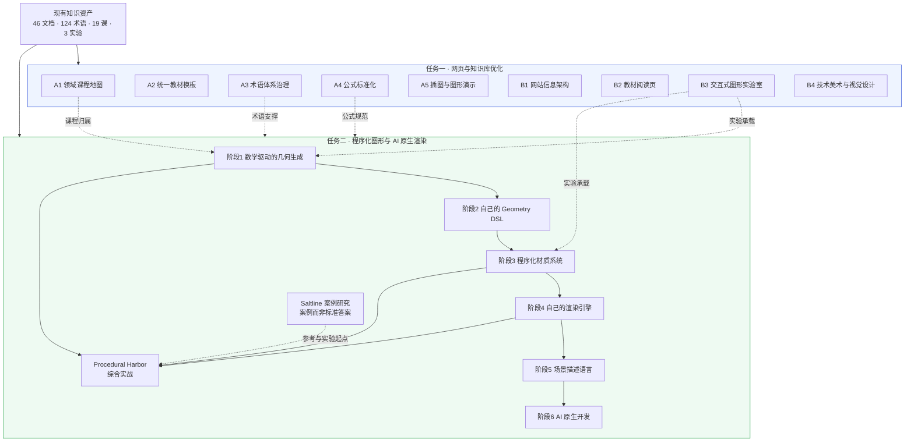
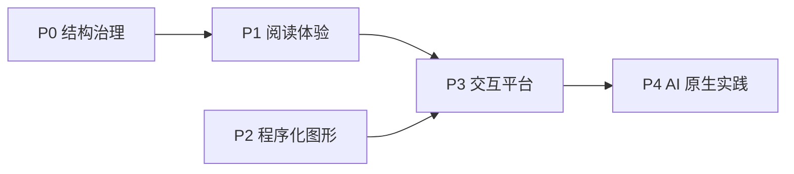

# Render_Notes 2.0 双线规划

> **文档定位**：这是整个 Render_Notes 升级的"总纲"。它不重写任何现有文档，而是在已有知识资产之上，把后续工作拆成**两条相互关联、但可独立推进的任务线**，并给出依赖图、阶段路线、验收标准与当前进度。
>
> **更新日期**：2026-11-18 · **状态**：持续维护 · **关联**：[知识架构总览](知识架构总览.md) · [学习路径指南](学习路径指南.md)

---

## 0. 一个必须先说清楚的判断

游戏与实时画面的画质，**不是由 Unity、Unreal、Cocos 这类引擎决定的**，而是由以下因素共同决定：

- 渲染算法（光照模型、阴影、后处理、时域算法）
- 几何质量（拓扑、细分、LOD、程序化生成）
- 材质与光照（PBR、IBL、程序纹理）
- 硬件能力（GPU 架构、带宽、特性集）

引擎的作用是把这些能力**组织起来**，提供开发、调试和运行的 infrastructure。真正决定最终画面的是几何、材质、光照、着色与计算本身。

这条判断决定了本项目两条任务线的共同目标：**从"会使用引擎"走向"理解、构造、扩展渲染系统"**。

---

## 1. 现状：我们站在哪里

经过前面的建设，知识库已经不是"内容太少"，而是"需要更好的组织与交互层"：

| 资产 | 现状 | 载体 |
|---|---|---|
| 主文档 | 46 篇，覆盖音视频、GPU、OpenGL ES、Vulkan、3D 渲染、图像算法、跨平台、车载渲染、程序化几何 | `01`–`07` 各章节 |
| 术语库 | 11 组 124 条，含"是什么/展开讲讲/为什么重要/容易混淆" | `tools/glossary.json` |
| 教材层 | 8 单元 19 课，含前置依赖、学习目标、阅读步骤、自检题、课程依赖图 | `tools/course.json` |
| 交互实验室 | 3 个实验（坐标变换 MVP、程序化旋转曲面、PBR 光照材质），Canvas 2D，参数可调、矩阵/数值实时显示、含自检 | `tools/labs.json` |
| 知识依赖图 | 交互式，2 张视图（主干 + 图形学交叉路径），节点可点击跳转，附离线链接兜底 | `tools/graph.json` · `#/graph` |
| 技术索引 | 从术语库自动生成，按 API/算法/概念/主题分类，124 条 | `#/tech` |
| 导航与索引 | 知识架构总览、学习路径指南、知识缺口登记表、验真队列与术语表 | `00-导航与索引/` |
| 阅读网站 | 离线静态站：侧栏、搜索、目录、进度、KaTeX、Mermaid（可点击放大/缩放/平移）、明暗主题、术语悬浮、教材模式、实验室、交互图谱、技术索引 | `web/` |

**核心矛盾**：现有组织方式仍偏向"按技术主题归档"，而不是"按学习者认知过程组织"。初学者需要先理解"为什么要有坐标变换"，再进入矩阵、模型/观察/投影空间，最后才是 MVP 与具体 API——这些前后依赖此前没有被明确表达。

**基本原则**（两条线共同遵守）：

1. 保留现有已验证的知识资产，不为重构而重写。
2. 优先修复知识结构与学习体验，再逐步扩充新领域。
3. 不把所有内容做成线性目录——知识之间是**依赖图**，不是一条线。
4. 不能只靠增加文字补知识——图形学需要看图、跑代码、调参数。
5. 不把 Saltline 或任何单一案例当作行业标准答案。

---

## 2. 两条任务线总览



两条线的关系：**任务一把"学与读"的体验做好，任务二把"新领域"的内容建起来**。任务一的实验室是任务二的实验载体，任务一的术语/公式规范是任务二的内容标准；任务二产生的新知识又回流进任务一的教材与课程地图。

---

## 3. 任务一：网页与知识库优化

**目标**：把现有资产组织成"系统教材 + 交互实验 + 统一术语"的阅读平台，让读者能按认知顺序学、能看懂每个名词、能通过交互验证原理。

### 3.1 A1 · 领域课程地图

在现有文档之上建立八个学习领域的课程归属（不移动原文件）：

| 领域 | 主要学习内容 | 现有文档承接 |
|---|---|---|
| 01 数学与图形学基础 | 线性代数、向量矩阵、几何、坐标变换、投影、光栅化 | `07-3D渲染与算法实现/3D变换与坐标空间.md`、`03-图形与GPU工程/光栅化深度与移动GPU架构.md` |
| 02 图形 API 与 GPU 基础 | OpenGL ES、Vulkan、WebGL、WebGPU、GPU 架构、Shader | `03`、`04`、`06` 相关文档 |
| 03 实时渲染技术 | 渲染管线、光照、阴影、PBR、IBL、后处理、色彩管理 | `07/光照材质与阴影.md`、`03/色彩管理与采样滤波.md` |
| 04 图像与视频 GPU 处理 | 纹理、滤波、卷积、降噪、超分、视频渲染、HDR | `07/GPU图像处理算法.md`、`01`、`02` |
| 05 程序化图形学 | 程序几何、参数曲面、Spline、SDF、噪声、程序纹理 | 任务二新建 |
| 06 现代 GPU 与渲染架构 | RenderGraph、GPU-driven、Mesh Shader、光追、资源管理 | `07/批处理与GPU驱动管线.md`、`04/显式API与同步原语.md` |
| 07 引擎与工程实践 | Cocos、Unity、Three.js、自定义渲染系统、跨平台与性能优化 | `04`、`05`、`06` |
| 08 AI 原生图形开发 | AI 辅助几何、Shader、场景生成、长程自主工程 | 任务二新建 |

- 原有音视频与跨平台播放知识保留为**独立媒体处理分支**，与图形渲染建立关联。
- 面试知识库不再作为整条路径的"最后一层"，而是**各领域的独立应用视图**。
- **验收**：每篇现有主文档都有明确的领域归属、学习层级和前置知识。

### 3.2 A2 · 统一教材模板

推荐 12 段式教学顺序（不强求每章全含，但遵循顺序）：

`本章目标 → 前置知识 → 问题引入 → 基础概念 → 数学原理 → 图形演示 → 工程实现 → GPU 执行过程 → 常见误区 → 性能与应用 → 实验与自测 → 术语与延伸阅读`

现状：教材层（`tools/course.json`）已有目标/前置/阅读/术语/自检；三个实验已分别绑定 L13（MVP）、L17（旋转曲面）、L18（PBR）并逐课双向连通；**待补**：其余 B3 清单实验与课程的绑定。

### 3.3 A3 · 术语体系治理

- 现有《验真队列与术语表》保留，升级为全局统一术语库（`tools/glossary.json`，已实现）。
- 每个术语唯一标准定义：中文名 / 英文名 / 缩写 / 简明解释 / 正式定义 / 公式或示意 / 首次引入章节 / 相关术语 / 参考资料。
- 三级解释：**L0 一句话 → L1 原理背景 → L2 工程与公式**（当前网站已实现 short/detail/why/confusion 四段，等价覆盖 L0–L2）。
- 正文首次出现给简短解释或跳转链接，后续直接引用统一术语（站内已实现首现注入）。
- **验收**：正文不再出现"突然一个概念看不懂"的断点。

### 3.4 A4 · 公式与数学内容标准化

- 统一 LaTeX，站点用 KaTeX 渲染（已实现）。
- 行内/独立公式区分；多行推导用 `aligned`；变量逐一解释；标注单位、取值范围、适用条件。
- 复杂公式给几何含义与直观示意；重要公式加参数变化演示（**实验室承担**）。
- 修复移动端公式溢出。
- **验收**：MVP 公式已在实验室以 KaTeX 展示，下一步推广到光照、PBR 等核心公式。

### 3.5 A5 · 插图与图形演示标准

避免无教学价值的装饰图；重点建设原创技术插图：坐标系与矩阵变换、顶点→片元执行流程、深度缓冲与 Z-Fighting、PBR 光照组成与 BRDF、GPU 内存与 RenderGraph、纹理生成采样滤波、程序化几何生成过程。每篇核心教材至少一组解释重点的图示，数学与实时渲染优先交互演示。

### 3.6 B1 · 网站信息架构

建议一级入口与现状对照：

| 建议入口 | 现状 |
|---|---|
| 首页 | ✅ 已有 |
| 学习课程 | ✅ 教材模式 |
| 知识地图 | ✅ 知识架构总览 + 课程依赖图（Mermaid） |
| 图形实验室 | ✅ 已有 1 个，持续扩充 |
| 术语词典 | ✅ 术语速查 |
| 技术索引 | ✅ 已有（从术语库自动生成，124 条） |
| 项目实战 | ✅ 已有项目实战指南（可与任务二 Procedural Harbor 打通） |

### 3.7 B2 · 教材阅读页

三栏式：左侧课程章节与前后关系 / 中间正文·公式·交互 / 右侧目录·术语·关联·延伸。当前为"侧栏 + 正文 + 目录"的实用三栏；代码高亮复制、KaTeX、Mermaid（点击全屏放大 / 缩放 / 平移）、术语悬浮、明暗主题已实现；**待补**："上一章/下一章"课时级导航。

### 3.8 B3 · 交互式图形实验室

优先演示清单与进度：

| 演示 | 交互内容 | 状态 |
|---|---|---|
| 坐标变换实验 | 位置/旋转/缩放，观察矩阵变化 | ✅ 已完成 |
| 程序化几何实验 | 修改参数，实时生成旋转曲面/Mesh | ✅ 已完成 |
| 相机与投影实验 | FOV、Near、Far、投影方式 | 🔄 在 MVP 实验内可调 FOV/投影，独立实验待建 |
| 光照实验 | 光源方向、强度、颜色 | ✅ 已在 PBR 实验内实现 |
| PBR 材质实验 | Metalness、Roughness | ✅ 已完成（PBR 光照与材质实验） |
| Shader 实验 | 编辑 GLSL，实时着色 | ⬜ 待建 |
| 纹理采样实验 | UV、Mipmap、过滤方式 | ⬜ 待建 |
| 程序化材质实验 | 噪声、锈迹、划痕、湿润 | ⬜ 待建 |
| 渲染管线实验 | 各 Pass 输入输出与中间结果 | ⬜ 待建 |

**硬性要求**：演示必须解释原理，而不是只提供一个可旋转的 3D 模型——每个实验都要有"参数 → 数学 → 画面"的可追踪链条。

### 3.9 B4 · 技术美术与视觉设计

清晰排版、合理层级与留白、高质量代码公式、统一图形插画风格、重要流程矢量图、重要算法动态画面、控制动效数量。现有站点已奠定基调，后续新增实验沿用同一套 CSS 变量与设计语言。

---

## 4. 任务二：程序化图形学与 AI 原生实时渲染

**目标**：建立一条与传统"引擎/模型工作流"互补的新知识路线——从"学 Mesh"到"用数学生成 Mesh"，从"用 PBR 材质"到"用 GLSL 构造材质"，从"用引擎"到"组合、扩展、构建轻量渲染运行时"，最终引入 AI 长程自主开发。

### 4.1 互补关系

| 现有知识路线 | 新增知识路线 |
|---|---|
| 学习 Mesh 和模型数据 | 学习如何通过数学生成 Mesh |
| 学习 UV 和纹理 | 学习程序化纹理生成 |
| 学习 PBR 材质系统 | 学习用 GLSL 构造 PBR 材质 |
| 学习粒子系统 | 学习 GPU 驱动的动态效果 |
| 学习场景管理 | 学习程序化场景生成 |
| 学习引擎渲染管线 | 学习组合、扩展、构建轻量渲染运行时 |
| 学习传统开发流程 | 学习 AI 长程自主开发、验证与迭代 |

### 4.2 六阶段技术发展路线

1. **阶段 1 · 数学驱动的几何生成**：参数曲面、Spline、Extrude、Loft、SDF、Noise。
2. **阶段 2 · 自己的 Geometry DSL**：几何描述、构造器、组合系统与几何编译器。
3. **阶段 3 · 自己的程序化材质系统**：GLSL、PBR、程序纹理、Shader 生成。
4. **阶段 4 · 自己的渲染引擎**：Vulkan 渲染管线、资源管理、RenderGraph、GPU-driven。
5. **阶段 5 · 自己的场景描述语言**：用语言描述整个三维世界，自动生成场景。
6. **阶段 6 · AI 原生开发**：让 AI 理解场景需求、生成 DSL、编写 Shader、运行测试并修复。

> **特别注意**："AI 辅助开发"与"运行时 AI 生成"是两个不同技术方向，分开学习，不混为一谈。

### 4.3 技术选型路线（重要取舍）

```
初期：OpenGL 4.5 / WebGL 2  →  先掌握渲染算法与程序化几何
中期：Vulkan                →  学习 GPU 资源管理、同步、RenderGraph 与现代渲染架构
后期：自建跨平台渲染抽象层   →  统一多后端、沉淀可复用运行时
```

**不要一开始就用 Vulkan 从零造一切。** Vulkan 的大量复杂性来自资源生命周期、内存管理、命令提交与同步，而不一定来自你真正想研究的图形学算法。先用 WebGL 2 把"几何怎么生成、材质怎么构造、画面怎么形成"跑通，再把 Vulkan 作为"理解现代 GPU 架构"的第二阶段。这与本项目"先做透一个示范模块"的策略一致。

### 4.4 Saltline 的定位

Saltline（Anthropic 工程师 Felix Rieseberg）代表的是一套**程序化图形与小规模游戏开发范式**：用数学生成几何、用 GLSL 构造材质、用轻量运行时组织场景，并大量借助 AI 辅助工程。

- ✅ 作为**案例研究与实验起点**：学习它的程序化建模、GLSL 材质、GPU 驱动效果与 AI 辅助工作流。
- ❌ 不作为**完整的现代游戏引擎范例**：它的场景、玩法、性能预算都有特定约束；第三方静态分析不等同于原作者逐项确认。
- 结论：拆解其思路，但不把每个实现当作标准答案。

### 4.5 综合实战：Procedural Harbor

以 Saltline 的程序化建模与渲染思路为参考，建设**程序化港口场景**作为综合项目（以 Three.js / WebGL 2 为初始实验环境，不要求先开发完整引擎）：

1. 生成基础几何体与集装箱 → 2. 加入仓库、机械、管道、道路 → 3. GLSL 生成锈迹、混凝土、油漆、湿润材质 → 4. 雨水、积水、波浪、环境光照 → 5. 反射、阴影、雾效、后处理 → 6. 优化 Mesh 合并、DrawCall、LOD、动态分辨率 → 7. 交互与简单玩法 → 8. 引入 AI 辅助，从场景描述自动生成几何与材质代码。

最终形成**可运行、可交互、可分析**的程序化渲染案例，并与面试知识库的"项目表达"打通。

---

## 5. 实施优先级与阶段路线

| 阶段 | 归属 | 关键工作 | 验收 |
|---|---|---|---|
| **P0 知识结构治理** | 任务一 | 领域课程地图、文档领域归属、教材模板、术语规范、网站 IA | 每篇主文档有领域/层级/前置 |
| **P1 阅读体验升级** | 任务一 | 公式规范、核心教学插图、术语治理、阅读页与移动端 | 一篇典型教材完整改造，形成可复用标准 |
| **P2 新增程序化图形学** | 任务二 | 程序几何、Geometry DSL、GLSL 程序材质、程序化环境、Saltline 案例 | 完成第一组可运行程序化图形实验 |
| **P3 交互式学习平台** | 任务一/二 | 坐标变换、程序几何、PBR、Shader、纹理采样实验 | 核心原理可通过操作验证 |
| **P4 AI 原生工程实践** | 任务二 | AI 图形工作流、描述到几何、参数化材质、Procedural Harbor | 一套可持续迭代的程序化渲染工程 |



---

## 6. 质量管理（全项目共识）

1. 重要技术结论有来源，区分**已验证 / 条件成立 / 待验证**。
2. 数学公式经过格式与正确性检查。
3. 专业名词首次出现提供解释，后续引用统一术语。
4. 重复知识必须有明确递进教学目的，不重复同一层内容。
5. 代码示例尽量可运行，不能运行标注为伪代码。
6. 插图必须与对应技术原理一致。
7. 互动实验说明参数含义、结果与性能影响。
8. 新增/修改文档后做链接、锚点、公式、术语校验。
9. 不把单个案例的技术选择包装成行业通用最佳实践。

---

## 7. 当前进度与下一步

### 已完成

- ✅ 三个端到端示范闭环（均为"文档→课时→术语→公式→交互→自检"）：
  - MVP 坐标变换实验（L13 + [3D变换与坐标空间](../07-3D渲染与算法实现/3D变换与坐标空间.md)）。
  - 程序化几何·旋转曲面（L17 + [程序化几何与旋转曲面](../07-3D渲染与算法实现/程序化几何与旋转曲面.md)，任务二阶段 1 成课）。
  - PBR 光照与材质（L18 + [光照材质与阴影 §3.6](../07-3D渲染与算法实现/光照材质与阴影.md)，教学近似）。
- ✅ 教材层 19 课 / 8 单元 + 课程依赖图 + 进度追踪；文档顶部课程条、课时内实验入口。
- ✅ 术语库 124 条（11 组，含 PBR 材质参数）+ 首现注入 + 悬浮解释 + 术语速查页。
- ✅ 交互式知识依赖图（2 张视图、节点可点击跳转、离线链接兜底）；L0–L7 编号已与总览统一。
- ✅ 技术索引（从术语库自动生成，124 条，按 API/算法/概念/主题分类）。
- ✅ QA 门禁 `tools/validate_site.py`（链接/锚点/课时/实验/术语/LaTeX/生成物校验）。
- ✅ 数学公式渲染修复：矩阵 `\\`/`&` 不再被 markdown 破坏；Stride 公式改为 LaTeX。
- ✅ 图示放大：所有 Mermaid 图支持全屏缩放/平移（长链路图可读）。
- ✅ 概念引入说明：DRAM/DMA/PCIe 与 Pass/RenderGraph 的层次与引入桥梁（含 Mermaid 图），补齐"术语突然冒出来"的断点。
- ✅ 故事线探索之旅：把 L0–L7 重排成六篇章（钩子→概念→桥→实践）的叙事学习路径。
- ✅ research-to-learning 项目技能：五角色调研→学习工作流 + 篇章弧线校验，用于按人类理解过程重排内容。
- ✅ 交互修复：组合键（如 Ctrl+C）不再误触发单字母导航。

### 本次推进

- ✅ 三实验统一新增 `selfTest`（`<details>` 展开答案 + localStorage 持久化）。
- ✅ 公式与依赖图的用户反馈已闭环（见第 6 节质量管理与 §3.6 B3）。
- ✅ 概念脱节/章节连贯性的用户反馈已闭环（概念引入说明 + 故事线 + research-to-learning 技能）。

### 下一步（按优先级）

1. 继续覆盖 B3 清单：相机与投影独立实验、Shader 编辑、纹理采样、程序化材质。
2. 任务二阶段 2/3：Geometry DSL 的设计与定时成课；Noise/SDF 教材条目 + 实验。
3. Procedural Harbor 综合实战的立项与场景拆解（以 Saltline 为案例研究起点，非标准答案）。
4. 每阶段继续跑 `validate_site.py` 门禁并做浏览器验收。

---

> 本规划是活文档：每完成一个阶段，更新第 7 节进度；新增领域或调整优先级时，同步更新第 2/4/5 节。所有技术判断遵循第 6 节质量管理。
