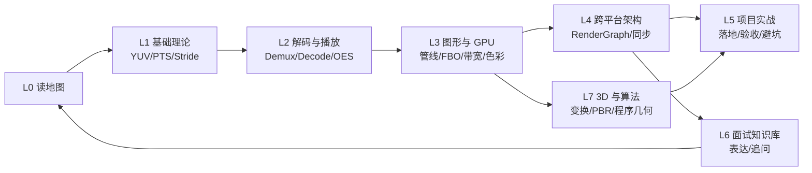

# 学习路径指南

> 从零基础到项目实战的递进路线。每层给出核心问题、推荐阅读、前置术语与阶段产出。
>
> **先看地图**：[知识架构总览](知识架构总览.md) 给出 L0–L7 分层、章节依赖与三条阅读路线；本页是**可执行的学习计划**。
>
> **术语突然冒出来？** 先读 [概念引入说明](概念引入说明.md)——讲清 DRAM/DMA/PCIe 与 Pass/RenderGraph 分别属于哪一层、为什么现在才出现。
>
> **想按故事线学？** [一帧画面的探索之旅](一帧画面的探索之旅.md) 把本页的周计划重排成六个有钩子、有桥、有实践的篇章。

---

## 0. 三条路线，按需选择

| 路线 | 适用人群 | 建议周期 | 每周投入 | 终点产出 |
|---|---|---|---|---|
| **A · 系统学习** | 想建立完整知识体系 | 12 周 | 8–10 小时 | 一张自绘知识地图 + 1 个可讲述项目 |
| **B · 面试冲刺** | 有工程经验，需结构化表达 | 3 天 | 8–12 小时/天 | 60 秒项目故事 + 高频题答案框架 |
| **C · 工程落地** | 正在做播放器/相机/车机渲染 | 4 周 | 10–12 小时 | 可评审的架构方案与验收清单 |

> 不建议跳过 L1–L3 直接看架构。RenderGraph、barrier、零拷贝都是对“一帧怎么来、怎么画”的答案，没有前置概念会变成背名词。

---

## 1. 学习路线总图

> **分层以 [知识架构总览](知识架构总览.md) 为准**：L0 导航 / L1 基础 / L2 解码 / L3 图形与 GPU / L4 跨平台架构 / L5 项目实战 / L6 面试知识库 / L7 3D 与算法。本页把它展开成可执行的学习顺序。



** Loop 的含义**：每一轮项目或面试复盘，都应回到 L0 更新自己的知识地图，而不是线性读完就结束。

> **交互版**：上面的依赖图是静态示意；网页里可点击、可跳转的版本见 [知识依赖图](#/graph)（快捷键 M），包含「主干知识依赖」与「图形学交叉路径」两张视图。

---

## 2. 12 周系统学习计划

### 第 1–2 周 · 建立底层词汇表

| 周 | 主题 | 必读 | 术语前置 | 产出 |
|---|---|---|---|---|
| W1 | 媒体三层模型、YUV/RGB、容器与编码 | [音视频基础理论](../01-基础理论/音视频基础理论.md) | [YUV 4:2:0](#/glossary?term=YUV%204:2:0) · [NV12 / NV21](#/glossary?term=NV12%20/%20NV21) · [Stride](#/glossary?term=Stride) | 用自己的话解释“MP4 和 H.264 的关系” |
| W2 | 时间戳、同步、色彩范围 | [音视频基础理论 §4](../01-基础理论/音视频基础理论.md) · [色彩管理与采样滤波](../03-图形与GPU工程/色彩管理与采样滤波.md) | [PTS](#/glossary?term=PTS) · [DTS](#/glossary?term=DTS) · [BT.709 limited range](#/glossary?term=BT.709%20limited%20range) | 画出 B 帧场景的 PTS/DTS 顺序图 |

**自测**：为什么忽略 stride 会花屏？为什么 limited range 直接当 full range 会发灰？

---

### 第 3–4 周 · 打通一帧视频的链路

| 周 | 主题 | 必读 | 术语前置 | 产出 |
|---|---|---|---|---|
| W3 | Demux/Decode/Render 职责边界 | [解码与播放链路 §1–2](../02-解码与播放链路/解码与播放链路.md) | [Demux](#/glossary?term=Demux) · [MediaCodec](#/glossary?term=MediaCodec) · [Codec](#/glossary?term=Codec) | 画出硬解/软解两条数据链 |
| W4 | Surface、OES、FBO 特效链 | [解码与播放链路 §6](../02-解码与播放链路/解码与播放链路.md) · [GPU 与渲染引擎基础与链路](../03-图形与GPU工程/GPU与渲染引擎基础与链路.md) | [OES](#/glossary?term=OES) · [SurfaceTexture](#/glossary?term=SurfaceTexture) · [FBO](#/glossary?term=FBO) | 说明“视频纹理化为什么是近零拷贝” |

**自测**：MediaCodec 为什么不负责 demux？OES 纹理为什么不能直接进普通多 Pass？

---

### 第 5–6 周 · 理解 GPU 与渲染管线

| 周 | 主题 | 必读 | 术语前置 | 产出 |
|---|---|---|---|---|
| W5 | GPU 硬件模型、带宽、占用率 | [GPU 与渲染引擎基础与链路 §1](../03-图形与GPU工程/GPU与渲染引擎基础与链路.md) | [SIMD](#/glossary?term=SIMD) · [warp](#/glossary?term=warp) · [带宽](#/glossary?term=带宽) · [occupancy](#/glossary?term=occupancy) | 估算 1080p 5 Pass 后处理链的带宽 |
| W6 | 管线阶段、FBO、DrawCall、Overdraw | [图形与GPU工程](../03-图形与GPU工程/图形与GPU工程.md) · [光栅化深度与移动GPU架构](../03-图形与GPU工程/光栅化深度与移动GPU架构.md) | [DrawCall](#/glossary?term=DrawCall) · [Overdraw](#/glossary?term=Overdraw) · [TBDR](#/glossary?term=TBDR) · [Early-Z](#/glossary?term=Early-Z) | 用一张图讲清 CPU→GPU→合成器→屏幕 |

**自测**：TOPS 高为什么不代表帧率高？MSAA 成本主要落在哪里？

---

### 第 7–8 周 · 工程架构与显式 API

| 周 | 主题 | 必读 | 术语前置 | 产出 |
|---|---|---|---|---|
| W7 | OpenGL 状态机 → 显式 API | [显式 API 与同步原语](../04-跨平台与高性能架构/显式API与同步原语.md) · [Vulkan 与显式 API 对照](../06-面试知识库/车载渲染引擎/02-Vulkan与显式API对照.md) | [OpenGL 状态机](#/glossary?term=OpenGL%20状态机) · [Vulkan](#/glossary?term=Vulkan) · [Barrier](#/glossary?term=Barrier) | 列出 GL 与 Vulkan 的 6 个关键差异 |
| W8 | RenderGraph、零拷贝、生命周期 | [跨平台与高性能架构](../04-跨平台与高性能架构/跨平台与高性能架构.md) · [智驾渲染方案](../04-跨平台与高性能架构/智驾渲染方案.md) | [RenderGraph](#/glossary?term=RenderGraph) · [零拷贝](#/glossary?term=零拷贝) · [Fence](#/glossary?term=Fence) · [Frame in flight](#/glossary?term=Frame%20in%20flight) | 设计一个硬解失败回退状态机 |

**自测**：RenderGraph 是优化性能还是管理复杂度？fence 和 semaphore 能否互换？

---

### 第 9–10 周 · 3D 与图像算法

| 周 | 主题 | 必读 | 术语前置 | 产出 |
|---|---|---|---|---|
| W9 | 坐标空间、光照、PBR | [3D 变换与坐标空间](../07-3D渲染与算法实现/3D变换与坐标空间.md) · [光照材质与阴影](../07-3D渲染与算法实现/光照材质与阴影.md) | [PBR](#/glossary?term=PBR) · [BRDF](#/glossary?term=BRDF) · [色彩空间](#/glossary?term=色彩空间) | 手写 MVP 变换说明 |
| W10 | 图像算法、批处理、GPU-driven | [GPU 图像处理算法](../07-3D渲染与算法实现/GPU图像处理算法.md) · [批处理与 GPU 驱动管线](../07-3D渲染与算法实现/批处理与GPU驱动管线.md) | [mipmap](#/glossary?term=mipmap) · [采样](#/glossary?term=采样) · [MSAA](#/glossary?term=MSAA) | 说明降噪/超分分别落在哪一层 |

**自测**：画面发灰、阴影漏光、边缘锯齿分别属于哪一层的问题？

---

### 第 11–12 周 · 项目复盘与表达

| 周 | 主题 | 必读 | 产出 |
|---|---|---|---|
| W11 | 项目重构、性能与画质评测 | [项目实战指南](../05-项目实战/项目实战指南.md) | 一份带设备矩阵与测试条件的复盘报告 |
| W12 | 面试表达与查漏补缺 | [面试知识库](../06-面试知识库/面试知识库.md) · [知识缺口登记表](知识缺口登记表.md) | 3 分钟项目故事 + 60 秒高光回答 |

**最终验收**：
- 能白板画出“MP4 → 解码 → OES → RenderGraph → 合成器 → 屏幕”的完整链路；
- 能指出任意一层的瓶颈、验证方法与常见错误；
- 能把一个优化讲成“问题 → 证据 → 方案 → 边界条件 → 结果”。

---

## 3. 3 天面试冲刺路线

### Day 1 · 搭骨架

1. [知识架构总览](知识架构总览.md) — 30 分钟，先记住 L0–L7。
2. [速问速答清单](../06-面试知识库/车载渲染引擎/00-面试速问速答清单.md) — 2 小时，标出不会的题。
3. [GPU 与渲染引擎基础与链路](../03-图形与GPU工程/GPU与渲染引擎基础与链路.md) — 2 小时，只补链路和瓶颈表。

**当日产出**：一张“我会 / 我不会 / 我说不清”的三栏清单。

### Day 2 · 补专题

- 上午：[OpenGL 管线/FBO](../06-面试知识库/车载渲染引擎/01-OpenGL管线-FBO与离屏渲染.md) + [Vulkan 对照](../06-面试知识库/车载渲染引擎/02-Vulkan与显式API对照.md)
- 下午：[Shader 题库](../06-面试知识库/车载渲染引擎/05-Shader编程与手写题库.md) + [DrawCall/管线定制](../06-面试知识库/车载渲染引擎/07-DrawCall优化与渲染管线定制.md)
- 晚上：[车载座舱专题](../06-面试知识库/车载渲染引擎/06-车载座舱专题与项目表达.md)

**当日产出**：每个专题写 3 个“一句话结论 + 一个反例”。

### Day 3 · 讲出来

1. 用 60 秒讲“最有技术含量的一次优化”。
2. 用 3 分钟讲“一个项目从目标到结果的完整故事”。
3. 对三栏清单中“说不清”的题，回查 [术语速查](#/glossary) 与对应文档。

**验收标准**：不看稿能说出 5 个关键术语的定义、适用边界和一个反例。

---

## 4. 4 周工程落地路线

| 周 | 目标 | 必读 | 交付物 |
|---|---|---|---|
| W1 | 明确场景与约束 | [解码与播放链路](../02-解码与播放链路/解码与播放链路.md) · [智驾渲染方案](../04-跨平台与高性能架构/智驾渲染方案.md) | 需求/约束表：分辨率、帧率、延迟、平台、降级策略 |
| W2 | 定架构与 ownership | [跨平台与高性能架构](../04-跨平台与高性能架构/跨平台与高性能架构.md) · [显式 API 与同步原语](../04-跨平台与高性能架构/显式API与同步原语.md) | 线程模型图 + buffer ownership 表 |
| W3 | 定验收与观测 | [项目实战指南 §5](../05-项目实战/项目实战指南.md) | 指标表：P50/P99 帧时间、丢帧率、首帧、内存峰值、功耗 |
| W4 | 复盘与降级 | [知识缺口登记表](知识缺口登记表.md) · [验真队列与术语表](验真队列与术语表.md) | 风险清单 + 回退路径 + 结论口径检查 |

**工程红线**：任何“提升 X% / 降低 Y%”的结论，没有设备型号、样本量与测试条件，只能写成趋势，不能写成保证。

---

## 5. 逐层知识点清单（保留版）

以下八层是原始细粒度清单，适合在 12 周计划中逐项勾选。

### 第一层：基础概念

**目标**：建立音视频与图形渲染的基本认知框架

| 序号 | 知识点 | 核心问题 | 推荐阅读 |
|---|---|---|---|
| 1 | 媒体三层数据 | 压缩层/原始层/显示层分别是什么？ | [01-基础理论 §1](../01-基础理论/音视频基础理论.md) |
| 2 | YUV与RGB | 为什么视频用YUV而不用RGB？ | [01-基础理论 §2](../01-基础理论/音视频基础理论.md) |
| 3 | 容器与编码 | MP4和H.264是什么关系？ | [01-基础理论 §3](../01-基础理论/音视频基础理论.md) |
| 4 | PTS与DTS | 为什么有B帧时DTS≠PTS？ | [01-基础理论 §4](../01-基础理论/音视频基础理论.md) |

**阶段检验**：能用自己的话解释“一个MP4视频从文件到屏幕经历了哪些步骤”。

### 第二层：数据流与时序

**目标**：理解音视频数据的完整流转链路

| 序号 | 知识点 | 核心问题 | 推荐阅读 |
|---|---|---|---|
| 5 | Demux→Decode→Render | 三个阶段的职责边界 | [02-解码与播放链路 §1](../02-解码与播放链路/解码与播放链路.md) |
| 6 | 软解 vs 硬解 | 为什么移动端优先硬解？ | [02-解码与播放链路 §2](../02-解码与播放链路/解码与播放链路.md) |
| 7 | 音画同步 | 为什么同步是时钟问题？ | [01-基础理论 §4](../01-基础理论/音视频基础理论.md) |
| 8 | Stride与内存对齐 | 为什么忽略Stride会花屏？ | [01-基础理论 §2](../01-基础理论/音视频基础理论.md) |

**阶段检验**：能画出“硬解路径”和“软解路径”的数据流向图。

> **延伸**：[流媒体与实时采集](../02-解码与播放链路/流媒体与实时采集.md)

### 第三层：API与实现

**目标**：掌握核心API的使用场景与差异

| 序号 | 知识点 | 核心问题 | 推荐阅读 |
|---|---|---|---|
| 9 | MediaCodec | 为什么它不能替代 demux？ | [02-解码与播放链路 §1](../02-解码与播放链路/解码与播放链路.md) |
| 10 | FFmpeg | 它的能力边界在哪？ | [02-解码与播放链路 §1](../02-解码与播放链路/解码与播放链路.md) |
| 11 | Surface体系 | 四个组件各自的角色？ | [02-解码与播放链路 §6](../02-解码与播放链路/解码与播放链路.md) |
| 12 | OpenGL ES | 状态机模型意味着什么？ | [03-图形与GPU工程 §1](../03-图形与GPU工程/图形与GPU工程.md) |

**阶段检验**：能解释“为什么TextureView灵活但可能更耗合成成本”。

### 第四层：优化与调试

**目标**：理解性能瓶颈的定位方法与优化手段

| 序号 | 知识点 | 核心问题 | 推荐阅读 |
|---|---|---|---|
| 13 | DrawCall | 为什么少了不一定更快？ | [03-图形与GPU工程 §3](../03-图形与GPU工程/图形与GPU工程.md) |
| 14 | 合图合批 | 三剑客各自解决什么瓶颈？ | [03-图形与GPU工程 §3](../03-图形与GPU工程/图形与GPU工程.md) |
| 15 | 纹理压缩 | KTX2 一定更快吗？ | [03-图形与GPU工程 §4](../03-图形与GPU工程/图形与GPU工程.md) |
| 16 | FBO与Overdraw | Ping-Pong 为什么必要？ | [03-图形与GPU工程 §5](../03-图形与GPU工程/图形与GPU工程.md) |

**阶段检验**：能用 RenderDoc 判断当前瓶颈在 CPU 还是 GPU。

### 第五层：3D 渲染与图像算法

**目标**：把“能画出三角形”提升到“画得正确、画得高效”

| 序号 | 知识点 | 核心问题 | 推荐阅读 |
|---|---|---|---|
| 17 | 变换与坐标空间 | MVP 怎么推导？NDC/Y-flip 为什么不一致？ | [3D变换与坐标空间](../07-3D渲染与算法实现/3D变换与坐标空间.md) |
| 18 | 光照与材质 | Phong 到 PBR 的因果链？ | [光照材质与阴影](../07-3D渲染与算法实现/光照材质与阴影.md) |
| 19 | GPU 图像算法 | 卷积、双边、LUT、降噪、超分怎么落地？ | [GPU图像处理算法](../07-3D渲染与算法实现/GPU图像处理算法.md) |
| 20 | 批处理与 GPU 驱动 | DrawCall 优化的终点在哪？ | [批处理与GPU驱动管线](../07-3D渲染与算法实现/批处理与GPU驱动管线.md) |

**阶段检验**：能解释“画面发灰、阴影漏光、边缘锯齿”分别属于哪一层的问题。

### 第六层：工程架构

**目标**：掌握跨平台架构设计思维

| 序号 | 知识点 | 核心问题 | 推荐阅读 |
|---|---|---|---|
| 21 | 零拷贝 | 为什么是目标不是保证？ | [04-跨平台架构 §1](../04-跨平台与高性能架构/跨平台与高性能架构.md) |
| 22 | RenderGraph | 解决性能问题还是复杂度问题？ | [04-跨平台架构 §2](../04-跨平台与高性能架构/跨平台与高性能架构.md) |
| 23 | 跨平台管道 | 三大平台各自的零拷贝路径？ | [04-跨平台架构 §1](../04-跨平台与高性能架构/跨平台与高性能架构.md) |
| 24 | AI互操作 | 如何实现 GPU-to-GPU 零拷贝？ | [04-跨平台架构 §4](../04-跨平台与高性能架构/跨平台与高性能架构.md) |
| 25 | 显式 API | fence/semaphore/barrier 怎么用？ | [显式API与同步原语](../04-跨平台与高性能架构/显式API与同步原语.md) |

**阶段检验**：能设计一个“硬解失败自动回退软解”的状态机。

### 第七层：项目实战

**目标**：将知识转化为可讲述的项目经验

| 序号 | 知识点 | 核心问题 | 推荐阅读 |
|---|---|---|---|
| 26 | testKTX重构 | 为什么压缩纹理路线必须废弃？ | [05-项目实战 §1-2](../05-项目实战/项目实战指南.md) |
| 27 | 低端设备调优 | 四条红线分别解决什么问题？ | [05-项目实战 §4](../05-项目实战/项目实战指南.md) |
| 28 | 性能评测 | 如何设计严谨的定量实验？ | [05-项目实战 §5](../05-项目实战/项目实战指南.md) |
| 29 | 画质评测 | PSNR/SSIM/VMAF 怎么选？ | [05-项目实战 §5.3](../05-项目实战/项目实战指南.md) |
| 30 | 面试表达 | 如何包装项目成果？ | [06-面试知识库](../06-面试知识库/面试知识库.md) |

**阶段检验**：能用 3 分钟口述完整的项目重构故事，包含量化成果和边界条件。

### 第八层：面试冲刺（车载渲染方向）

**目标**：在 1–3 天内把知识组织成可回答的结构

| 序号 | 模块 | 核心问题 | 推荐阅读 |
|---|---|---|---|
| 31 | 速问速答 | 高频题如何一句话答到点上？ | [00-面试速问速答清单](../06-面试知识库/车载渲染引擎/00-面试速问速答清单.md) |
| 32 | OpenGL / FBO | 管线、帧缓存、离屏渲染怎么讲？ | [01-OpenGL管线-FBO与离屏渲染](../06-面试知识库/车载渲染引擎/01-OpenGL管线-FBO与离屏渲染.md) |
| 33 | Vulkan | 显式 API 与 GL 怎么映射？ | [02-Vulkan与显式API对照](../06-面试知识库/车载渲染引擎/02-Vulkan与显式API对照.md) |
| 34 | 引擎架构 | Cocos / Unity 的渲染机制？ | [03-引擎架构-Cocos与Unity](../06-面试知识库/车载渲染引擎/03-引擎架构-Cocos与Unity.md) |
| 35 | 3D 图形学 | 变换、光照、阴影、PBR？ | [04-3D图形学与几何原理](../06-面试知识库/车载渲染引擎/04-3D图形学与几何原理.md) |
| 36 | Shader | 现场手写十二个 shader | [05-Shader编程与手写题库](../06-面试知识库/车载渲染引擎/05-Shader编程与手写题库.md) |
| 37 | 车载座舱 | 多屏、安全、启动时间怎么答？ | [06-车载座舱专题与项目表达](../06-面试知识库/车载渲染引擎/06-车载座舱专题与项目表达.md) |
| 38 | 管线定制 | DrawCall、自定义管线、引擎内部改造 | [07-DrawCall优化与渲染管线定制](../06-面试知识库/车载渲染引擎/07-DrawCall优化与渲染管线定制.md) |

**阶段检验**：能在 60 秒内回答“你做过的最有技术含量的一次渲染优化是什么”。

---

## 6. 复盘模板

每完成一层，按下面四问写 5–10 行笔记：

```text
1. 这层解决了什么问题？（用一句用户能听懂的话）
2. 我原来哪里想错了？（旧认知 → 新认知）
3. 哪个术语最容易混淆？（术语 A vs 术语 B）
4. 能不能举一个反例？（什么条件下结论不成立）
```

> 写不出第 4 条，说明还停留在背结论阶段。

---

## 7. 维护规则

1. 新增文档必须归入 [知识架构总览](知识架构总览.md) 的 L0–L7 某层。
2. 新增路线或阶段目标时，同步更新本页的路线表与 12 周计划。
3. 新增原理性术语写入 `tools/glossary.json`，构建时自动生成跳转链接。
4. 学习路线中的时间投入是建议值，按个人基础调整，但**阶段产出不可跳过**。
