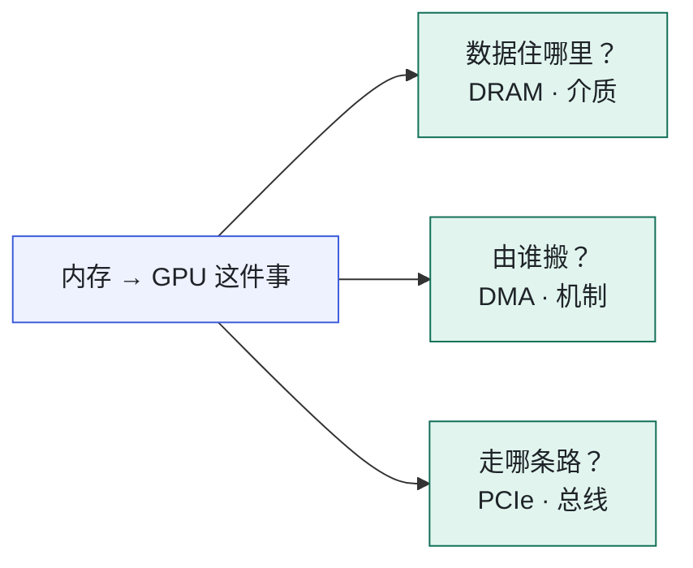
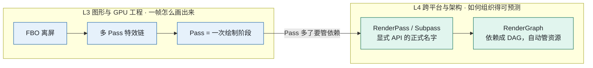

# 概念引入说明：数据通路与 Pass / RenderGraph

> **定位**：补上知识库里两处"术语突然冒出来"的断点。一篇讲清**数据到底怎么从硬盘走到屏幕、DRAM / DMA / PCIe 分别是什么**；另一篇讲清 **Pass / RenderGraph 为什么在"学渲染"时没见过、突然出现属于哪一层**。
>
> **适合谁读**：学到 L3–L4 时，被"一会儿 DRAM、一会儿 DMA、一会儿 PCIe"或"RenderGraph 是哪冒出来的"卡住的人。建议读完本文再回 [GPU与渲染引擎基础与链路](../03-图形与GPU工程/GPU与渲染引擎基础与链路.md) 与 [跨平台与高性能架构](../04-跨平台与高性能架构/跨平台与高性能架构.md)。
>
> **验证状态**：✅已验证（概念定义与平台分层）/ ⚠️有条件成立（具体平台的总线实现差异）

---

## 0. 一句话回答

- **DRAM 是"东西本身"**（内存芯片），**DMA 是"搬运方式"**（硬件自己搬，不经过 CPU 逐个搬运），**PCIe 是"那条路"**（PC 上 CPU 与独显之间的物理总线）。三者回答三个不同问题，不是同一件事的三种叫法。
- **Pass / RenderGraph 不是新东西**：Pass 就是你早见过的"多 Pass 特效链"里的一次绘制阶段，属于 L3；RenderGraph 是把多个 Pass 的依赖画成 DAG、统一管理资源的工程抽象，属于 L4。它们"突然出现"是因为知识库在 L3 用的是 FBO 术语，到 L4 换成了 API 正式名字，中间的翻译以前没写。

---

## 1. 数据通路：DRAM / DMA / PCIe 各是什么

### 1.1 三个词属于三个维度

| 词 | 全称 | 属于哪一维 | 回答的问题 | 类比 |
|---|---|---|---|---|
| **DRAM** | Dynamic Random Access Memory | **存储介质**（是什么） | 数据住在哪里 | 仓库本身 |
| **DMA** | Direct Memory Access | **传输机制**（怎么搬） | 数据由谁搬、要不要 CPU 亲自搬 | 搬运工（叉车） |
| **PCIe** | PCI Express | **物理总线**（走哪条路） | 两个芯片之间用哪条线连 | 仓库之间的公路 |

要点：**DRAM 是名词（地方），DMA 是动词（方式），PCIe 是路（通道）**。把它们并列比较"哪个负责传输"本身就是维度错配——真正"负责搬"的是 DMA 机制，而它走的"路"在 PC 上是 PCIe；被搬的东西平时就待在 DRAM 里。



> 图：三个词回答三个不同问题，不是同一件事的三种叫法。点击可放大。

### 1.2 修正你的数据流转链

你记的链条是：

```text
硬盘 →(IO)→ 内存 →(PCI-E)→ 显存 →(管线)→ 帧缓冲 →(显示器)→ 屏幕
```

这条链**前半段是 PC 独立显卡模型，看起来合理；但直接套到手机/车机 SoC 上是错的**——移动 SoC 里 CPU 和 GPU 共享同一块物理 DRAM，中间根本没有 PCIe，也没有"内存再拷到独立显存"这一步。分平台看才不会混：

**PC / 独立显卡**（有独立显存）

```text
硬盘 →(DMA/IO)→ 系统内存 DRAM →(PCIe 总线 + DMA 搬移)→ 显存 GDDR DRAM
     →(GPU 管线)→ 帧缓冲(仍在显存) →(DP/HDMI)→ 显示器 → 屏幕
```

**手机 / 车机 SoC**（本知识库主要语境，统一内存）

```text
闪存 →(IO)→ 共享物理 DRAM  ←→(GPU 直接采样同一块物理页，dma-buf/gralloc 共享)→ GPU 管线
     →(帧缓冲仍在共享 DRAM) →(DSI/HDMI/Overlay)→ 屏幕
```

### 1.3 那么"从 CPU / 内存传到 GPU"到底是哪个？

按平台与问题分别回答：

| 场景 | 物理路径（走哪条路） | 搬运机制（怎么搬） | 是否拷贝像素 |
|---|---|---|---|
| PC 独显：上传纹理 | PCIe 总线 | DMA（CPU 写系统内存，GPU 经 PCIe 读取；或驱动发起 DMA） | 有，跨总线拷贝 |
| PC 独显：硬解视频 | PCIe 总线 | GPU 经 PCIe 读解码缓冲，或 NVDEC→CUDA→GL 互操作 | 尽量低拷贝 |
| 移动 SoC：硬解视频 | 无 PCIe，共享 DRAM | dma-buf / Gralloc 共享文件描述符，GPU 采样同一物理页 | 近零拷贝（CPU 不搬像素） |
| 移动 SoC：上传纹理 | 无 PCIe，共享 DRAM | `glTexImage2D` 或 AHardwareBuffer 绑定 | 前者拷贝，后者共享 |

**结论**：

1. **负责"内存 → GPU"的物理通路**：PC 独显是 **PCIe**，移动 SoC 是**共享内存控制器 / 互连**，没有 PCIe。
2. **负责"搬运"这个动作的机制**：是 **DMA**（及其在移动端的近亲 dma-buf / AHardwareBuffer 共享）。
3. **DRAM 不是通路也不是机制**，它是被搬运的数据所存放的**介质**。

> ⚠️有条件成立：具体是否走 PCIe、是否有独立显存，取决于平台（独显 PC / 集显 PC / 移动 SoC / 车机）与驱动。面试表达时**先说平台，再说通路**，不要给一个跨平台都成立的绝对答案。

### 1.4 与已有文档的对应

- 硬解路径中的 `DMA-BUF / Gralloc`：见 [解码与播放链路 §硬解路径](../02-解码与播放链路/解码与播放链路.md)。
- 零拷贝本质（"CPU 不参与像素搬移"）：见 [跨平台与高性能架构 §1.1](../04-跨平台与高性能架构/跨平台与高性能架构.md#11-零拷贝的本质)。
- 对齐要求里的 DMA / Cache Line：见 [音视频基础理论 §DMA/Cache Line 对齐](../01-基础理论/音视频基础理论.md)。

---

## 2. Pass / RenderGraph：为什么学渲染时没遇到

### 2.1 它们在哪一层

| 概念 | 层次 | 属于的问题 | 首次应出现的位置 |
|---|---|---|---|
| **FBO / 离屏渲染** | L3 图形与 GPU 工程 | 一帧怎么画出来 | [图形与GPU工程 §5](../03-图形与GPU工程/图形与GPU工程.md) |
| **多 Pass 特效链** | L3 图形与 GPU 工程 | 一帧怎么画出来 | 同上 §5.3（多次离屏串联） |
| **Pass（一次绘制阶段）** | L3 → L4 过渡 | 给"一次渲染到目标"起正式名字 | [显式API与同步原语 §6](../04-跨平台与高性能架构/显式API与同步原语.md#6-renderpass-subpass-load-store) |
| **RenderPass / Subpass** | L4 跨平台与高性能架构 | 显式 API 里如何声明与同步 | 同上 |
| **RenderGraph** | L4 跨平台与高性能架构 | 多个 Pass 的依赖与资源如何统一管理 | [跨平台与高性能架构 §2](../04-跨平台与高性能架构/跨平台与高性能架构.md#2-rendergraph-架构设计) |

**为什么"学渲染"时没见过**：L3 之前你学的是**单条管线怎么把一帧画出来**（顶点→光栅→片元→屏幕）。Pass 与 RenderGraph 解决的是**"一帧里要画很多遍、这些遍之间怎么组织"**——这是工程化问题，不是"画得对不对"的问题。所以它们天然属于 L4，在 L3 用不到、也不该硬塞。

### 2.2 断点在哪里：同一件事，两个名字

知识库以前在 L3 说"**FBO / 多 Pass 特效链**"，到 L4 直接换口吻说"**Pass / RenderPass / RenderGraph**"，中间省了一句最重要的翻译：

> **Pass 就是一次"渲染到某个目标"的阶段。你在 L3 做的"绑定 FBO A 画一遍、再绑定 FBO B 画一遍"，其实就是两个 Pass；只是 OpenGL 里你手动管 FBO，Vulkan 里 API 要求你显式声明 RenderPass，于是它有了正式名字。**

于是读者会误以为"Pass 是 L4 才有的新东西"。实际上下面这张图把整条引入链画出来了：



> 图：你其实在 L3 就见过 Pass（叫"多 Pass 特效链"），只是到 L4 换了正式名字；RenderGraph 是再往上一层的工程管理。

实际上：

- **Pass = 一次绘制阶段**（把场景画到某张离屏纹理或屏幕）。L3 的 FBO 特效链里每个环节都是一个 Pass，只是当时叫"离屏 FBO"。
- **RenderPass / Subpass = Pass 在显式 API 里的正式声明形式**：Vulkan 要求你提前写出"这次要用到哪些附件、每个子阶段读谁写谁"，见 [显式API §6](../04-跨平台与高性能架构/显式API与同步原语.md#6-renderpass-subpass-load-store)。
- **RenderGraph = 当 Pass 多起来（阴影、主场景、后处理…）时，用一张 DAG 描述"谁写哪张纹理、谁读哪张、何时可释放"，由框架自动插同步屏障、复用显存**。它解决的是**复杂度与正确性**，不是画质。见 [跨平台与高性能架构 §2](../04-跨平台与高性能架构/跨平台与高性能架构.md#2-rendergraph-架构设计)。

### 2.3 为什么"感觉脱节、需要前置知识才懂"

这是真实存在的编排问题，不是你的问题。原因有三：

1. **命名断层**：L3 用 FBO / 特效链，L4 用 Pass / RenderGraph，没有一句话把两者等号。
2. **动机后置**：RenderGraph 的价值（省显存、自动同步）只有在 Pass ≥ 3 且有分支时才能体会；单 Pass 场景用它是负担。所以"为什么需要它"必须等读者见过复杂管线后才讲得通——现在本文补上了这座桥。
3. **术语密度**：L4 同时出现 RenderPass、Subpass、Barrier、Fence、aliasing、Frame in flight，缺一个"哪个解决哪个问题"的总览。

**缓解方式**：遇到陌生术语时，先问三件事——① 它属于哪一层（L3 画帧 / L4 组织）？② 它解决"画得对"还是"管得住"？③ 它是不是我已学概念的正式名字？这三问能消掉大部分"莫名其妙引入"的感觉。

---

## 3. 自检

1. DRAM / DMA / PCIe 分别回答什么问题？为什么不能说"PCIe 比 DMA 更快"？
2. 手机 SoC 上"内存 → 显存走 PCIe"这句话为什么错？正确说法是什么？
3. RenderGraph 属于哪一层、解决什么问题？它和 FBO 特效链是什么关系？
4. 一个只有主场景 + 一次色调映射（共 2 个 Pass）的场景，值得上 RenderGraph 吗？为什么？（提示：见 [跨平台架构 §2.2 边界](../04-跨平台与高性能架构/跨平台与高性能架构.md#22-边界-有条件成立) 与验真表 C06）

---

## 4. 术语与延伸

- 本文涉及的术语：DRAM、DMA、PCIe、显存、帧缓冲、RenderPass、Subpass、RenderGraph、多 Pass、零拷贝——均可在术语速查中查看。
- 延伸：[验真队列与术语表](验真队列与术语表.md)（C06/C07、V05 的边界条件）、[知识架构总览 §依赖关系说明](知识架构总览.md#1-知识地图)（先有 L3 才有 L4 的理由）。
