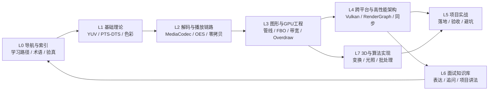

# 知识架构总览

> **定位**：这张页面是整套笔记的“地图”。它回答三个问题：知识库分几层、每层解决什么问题、概念看不懂时从哪里进入。
>
> **阅读方式**：先看地图，再按路线进入章节；正文中带虚线下划线的术语可悬停查看，点击可进入术语速查页。
>
> **升级总纲**：本页描述"知识如何组织"，项目"后续如何推进"见 [Render_Notes 2.0 双线规划](Render_Notes_2.0_双线规划.md)——两条任务线、依赖图与阶段路线都在那里维护。

---

## 0. 一句话架构

这套知识库沿着一条主线展开：

**码流 / 场景数据 → 解码或场景更新 → GPU 资源与渲染管线 → 系统合成与显示 → 性能与工程约束 → 面试表达**

对应八个模块：

| 层 | 模块 | 核心问题 | 必读入口 |
|---|---|---|---|
| L0 | 导航与索引 | 我该先读什么？概念去哪查？ | [学习路径指南](学习路径指南.md) · [术语表](验真队列与术语表.md) |
| L1 | 基础理论 | 图像、视频、颜色、时间戳到底是什么？ | [音视频基础理论](../01-基础理论/音视频基础理论.md) |
| L2 | 解码与播放链路 | 一帧视频如何从文件走到纹理？ | [解码与播放链路](../02-解码与播放链路/解码与播放链路.md) |
| L3 | 图形与 GPU 工程 | GPU 为什么快？一帧怎么画出来？ | [GPU 与渲染引擎基础与链路](../03-图形与GPU工程/GPU与渲染引擎基础与链路.md) |
| L4 | 跨平台与高性能架构 | 如何显式管理资源、同步和生命周期？ | [跨平台与高性能架构](../04-跨平台与高性能架构/跨平台与高性能架构.md) |
| L5 | 项目实战 | 工程上如何落地、验收、避坑？ | [项目实战指南](../05-项目实战/项目实战指南.md) |
| L6 | 面试知识库 | 如何把知识讲成有结构的答案？ | [面试知识库](../06-面试知识库/面试知识库.md) |
| L7 | 3D 与算法实现 | 几何、光照、批处理怎么落到 shader？ | [3D 渲染与算法实现](../07-3D渲染与算法实现/README.md) |

> L1–L4 是主干；L5–L7 是应用与表达；L0 是随时回看的索引层。

---

## 1. 知识地图

> **交互版**：本图是静态示意。网页里可点击节点、跳转到对应文档/课时/实验的版本见 [知识依赖图](#/graph)（快捷键 M），另含「图形学交叉路径」视图。



### 依赖关系说明

- **先有 L1，才有 L2**：不知道 YUV、PTS/DTS、Stride，就无法理解解码输出为什么不是 RGB、为什么顺序会乱。
- **先有 L2，才有 L3**：视频纹理化是移动端 GPU 管线的典型输入，OES 纹理是 L2 与 L3 的接缝。
- **先有 L3，才有 L4**：RenderGraph、barrier、PSO 都是对“一帧如何画出来”的工程化组织。
- **L5/L6/L7 是横向展开**：项目落地、面试表达、算法实现都依赖主干，但彼此可以并行阅读。

---

## 2. 各章节详解

### ◈ 00 · 导航与索引

| 文档 | 作用 |
|---|---|
| [学习路径指南](学习路径指南.md) | 按阶段给阅读顺序与阶段检验 |
| [概念引入说明](概念引入说明.md) | DRAM/DMA/PCIe 与 Pass/RenderGraph：术语为何出现、属于哪层 |
| [一帧画面的探索之旅](一帧画面的探索之旅.md) | 把 L0–L7 串成有钩子、有桥、有实践的故事线 |
| [知识缺口登记表](知识缺口登记表.md) | 记录已补齐/待补齐主题与依赖关系 |
| [验真队列与术语表](验真队列与术语表.md) | 断言验真状态 + 基础术语定义 |
| [知识架构总览](知识架构总览.md) | 本页，整体地图与概念入口 |

**核心问题**：我现在该读哪一篇？这个概念属于哪一层？

---

### ◈ 01 · 基础理论

- 入口：[音视频基础理论](../01-基础理论/音视频基础理论.md)
- 关键概念：[YUV 4:2:0](#/glossary?term=YUV%204:2:0) · [NV12 / NV21](#/glossary?term=NV12%20/%20NV21) · [PTS](#/glossary?term=PTS) · [DTS](#/glossary?term=DTS) · [Stride](#/glossary?term=Stride) · [BT.709 limited range](#/glossary?term=BT.709%20limited%20range)
- 读完应能回答：为什么视频不是 RGB？为什么 PTS 和 DTS 会分离？为什么 stride 错了会花屏？

---

### ◈ 02 · 解码与播放链路

- 入口：[解码与播放链路](../02-解码与播放链路/解码与播放链路.md)
- 延伸：[流媒体与实时采集](../02-解码与播放链路/流媒体与实时采集.md)
- 关键概念：[Demux](#/glossary?term=Demux) · [MediaCodec](#/glossary?term=MediaCodec) · [OES](#/glossary?term=OES) · [SurfaceTexture](#/glossary?term=SurfaceTexture) · [零拷贝](#/glossary?term=零拷贝)
- 读完应能回答：一帧 MP4 如何变成 GPU 可采样的纹理？ ownership 在哪一层切换？

---

### ◈ 03 · 图形与 GPU 工程

- 入口：[GPU 与渲染引擎基础与链路](../03-图形与GPU工程/GPU与渲染引擎基础与链路.md)
- 分支：[图形与GPU工程](../03-图形与GPU工程/图形与GPU工程.md) · [光栅化深度与移动GPU架构](../03-图形与GPU工程/光栅化深度与移动GPU架构.md) · [色彩管理与采样滤波](../03-图形与GPU工程/色彩管理与采样滤波.md)
- 关键概念：[SIMD](#/glossary?term=SIMD) · [warp](#/glossary?term=warp) · [带宽](#/glossary?term=带宽) · [FBO](#/glossary?term=FBO) · [DrawCall](#/glossary?term=DrawCall) · [TBDR](#/glossary?term=TBDR)
- 读完应能回答：GPU 为什么快？瓶颈为什么常在带宽而不是算力？一帧从场景到屏幕经过哪些阶段？

---

### ◈ 04 · 跨平台与高性能架构

- 入口：[跨平台与高性能架构](../04-跨平台与高性能架构/跨平台与高性能架构.md)
- 分支：[显式API与同步原语](../04-跨平台与高性能架构/显式API与同步原语.md) · [智驾渲染方案](../04-跨平台与高性能架构/智驾渲染方案.md)
- 关键概念：[Vulkan](#/glossary?term=Vulkan) · [RenderGraph](#/glossary?term=RenderGraph) · [Barrier](#/glossary?term=Barrier) · [Fence](#/glossary?term=Fence) · [Frame in flight](#/glossary?term=Frame%20in%20flight)
- 读完应能回答：为什么要显式管理资源与同步？智驾场景为什么不能只依赖座舱 GPU？

---

### ◈ 05 · 项目实战

- 入口：[项目实战指南](../05-项目实战/项目实战指南.md)
- 关键问题：怎么定阶段目标？怎么验收？哪些结论必须标注测试条件？
- 读完应能回答：如何把知识变成可交付、可复盘、可面试讲述的项目经历？

---

### ◈ 06 · 面试知识库

- 入口：[面试知识库](../06-面试知识库/面试知识库.md)
- 快速冲刺：[车载渲染速问速答清单](../06-面试知识库/车载渲染引擎/00-面试速问速答清单.md)
- 专题：[OpenGL 管线与 FBO](../06-面试知识库/车载渲染引擎/01-OpenGL管线-FBO与离屏渲染.md) · [Vulkan 对照](../06-面试知识库/车载渲染引擎/02-Vulkan与显式API对照.md) · [Shader 题库](../06-面试知识库/车载渲染引擎/05-Shader编程与手写题库.md) · [车载座舱专题](../06-面试知识库/车载渲染引擎/06-车载座舱专题与项目表达.md)
- 读完应能回答：同一个知识点，怎样讲成“结论 + 原理 + 工程约束 + 反例”？

---

### ◈ 07 · 3D 渲染与算法实现

- 入口：[3D 渲染与算法实现 README](../07-3D渲染与算法实现/README.md)
- 分支：[3D 变换与坐标空间](../07-3D渲染与算法实现/3D变换与坐标空间.md) · [光照材质与阴影](../07-3D渲染与算法实现/光照材质与阴影.md) · [程序化几何与旋转曲面](../07-3D渲染与算法实现/程序化几何与旋转曲面.md) · [GPU 图像处理算法](../07-3D渲染与算法实现/GPU图像处理算法.md) · [批处理与 GPU 驱动管线](../07-3D渲染与算法实现/批处理与GPU驱动管线.md)
- 关键概念：[LOD](#/glossary?term=LOD) · [MSAA](#/glossary?term=MSAA) · [PBR](#/glossary?term=PBR) · [BRDF](#/glossary?term=BRDF) · [程序化几何](#/glossary?term=程序化几何) · [Aliasing](#/glossary?term=Aliasing)
- 交互实验：[坐标变换与 MVP](#/lab/transform-mvp) · [旋转曲面生成](#/lab/procedural-lathe) · [PBR 光照与材质](#/lab/pbr-lighting)
- 读完应能回答：矩阵、光照、采样、批处理如何真正落到 shader 和 Pass 上？形状如何用数学生成而非从文件导入？

---

## 3. 三条推荐路线

### 路线 A · 系统入门（建议 2–3 周）

```text
知识架构总览
 → 音视频基础理论
 → 解码与播放链路
 → GPU 与渲染引擎基础与链路
 → 跨平台与高性能架构
 → 项目实战指南
```

适合：想建立完整知识地图，而不是碎片化刷题。

### 路线 B · 面试冲刺（建议 3 天）

```text
知识架构总览
 → 车载渲染速问速答清单
 → 面试知识库
 → OpenGL 管线 / Vulkan 对照 / Shader 题库
 → 车载座舱专题与项目表达
```

适合：已有工程经验，需要把知识组织成表达结构。

### 路线 C · 工程落地

```text
解码与播放链路
 → GPU 与渲染引擎基础与链路
 → 显式 API 与同步原语
 → 跨平台与高性能架构
 → 批处理与 GPU 驱动管线
 → 项目实战指南
```

适合：正在做播放器、相机、视频编辑、车机 HMI 或可视化引擎。

---

## 4. 概念锚点：看不懂时从这里进

| 如果你看到 | 先读 | 然后回到 |
|---|---|---|
| PTS/DTS/Stride | [音视频基础理论](../01-基础理论/音视频基础理论.md) | 解码与播放链路 |
| OES/SurfaceTexture/零拷贝 | [解码与播放链路](../02-解码与播放链路/解码与播放链路.md) | GPU 管线章节 |
| FBO/Pass/DrawCall/Overdraw | [GPU 与渲染引擎基础与链路](../03-图形与GPU工程/GPU与渲染引擎基础与链路.md) | 工程架构章节 |
| Barrier/Fence/RenderGraph | [显式 API 与同步原语](../04-跨平台与高性能架构/显式API与同步原语.md) | 项目实战与面试表达 |
| Vulkan SC/安全岛/BEV/AR-HUD | [智驾渲染方案](../04-跨平台与高性能架构/智驾渲染方案.md) | 车载座舱专题 |
| 矩阵/光照/PBR/MSAA | [3D 变换与坐标空间](../07-3D渲染与算法实现/3D变换与坐标空间.md) | Shader 与算法实现 |

> 网页阅读版中，以上术语均可直接点击跳转到术语速查页查看讲义式解释。

---

## 5. 维护规则

1. 新增文档必须归入 L0–L7 某一层，并在本页“章节详解”中出现。
2. 新增原理性术语必须写入 `tools/glossary.json`，构建时会自动生成跳转链接和本章术语卡片。
3. 面试结论必须带**条件约束**；无法证明的数据降级为“[测试数据-仅供参考]”。
4. 章节之间的前置关系发生变化时，同步更新本页 Mermaid 图与依赖说明。
