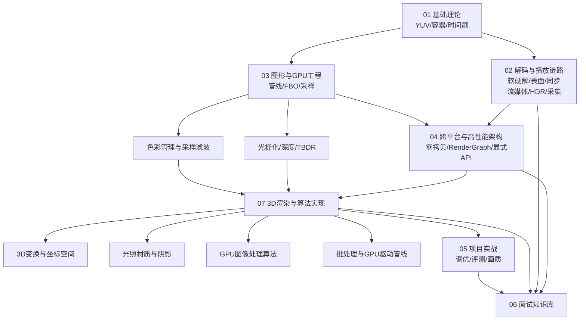

# 知识缺口登记表

> **定位**：记录"当前知识库还没有覆盖、但值得补"的主题，替代只列断言的验真队列。每条缺口都给出落点、优先级与验收标准，避免下一次审计重复发现同一件事。
>
> **状态**：P0 / P1 / 02 播放链路补齐已完成（2026-11-03），其余 P2 待按兴趣推进。

---

## 一、已补齐（P0 / P1）

| 原缺口 | 落点 | 状态 |
|---|---|---|
| 色彩管理、gamma/sRGB、线性工作流、HDR、色带 | [色彩管理与采样滤波](../03-图形与GPU工程/色彩管理与采样滤波.md) | ✅ |
| 采样与滤波、Mipmap、各向异性、图集渗色 | 同上 §5 | ✅ |
| 光栅化规则、MSAA、深度/模板、Early-Z、TBDR | [光栅化深度与移动GPU架构](../03-图形与GPU工程/光栅化深度与移动GPU架构.md) | ✅ |
| 变换数学完整推导、NDC/深度范围、Y-flip、法线矩阵 | [3D变换与坐标空间](../07-3D渲染与算法实现/3D变换与坐标空间.md) | ✅ |
| Phong→PBR、IBL、阴影/CSM、AO、Forward/Deferred | [光照材质与阴影](../07-3D渲染与算法实现/光照材质与阴影.md) | ✅ |
| 可分离卷积、双边/引导、3D LUT、降噪、插帧、超分 | [GPU图像处理算法](../07-3D渲染与算法实现/GPU图像处理算法.md) | ✅ |
| Instancing、间接绘制、Bindless、meshlet、GPU-driven、LOD、PSO | [批处理与GPU驱动管线](../07-3D渲染与算法实现/批处理与GPU驱动管线.md) | ✅ |
| 显式 API、fence/semaphore、barrier、subpass、显存 | [显式API与同步原语](../04-跨平台与高性能架构/显式API与同步原语.md) | ✅ |
| 画质指标 PSNR/SSIM/VMAF/MOS、码率-质量曲线 | [项目实战 §5.3](../05-项目实战/项目实战指南.md#53-画质指标) | ✅ |
| HLS/DASH/LL-HLS/CMAF、ABR、首帧与缓冲 | [流媒体、HDR 与实时采集 §2-4](../02-解码与播放链路/流媒体与实时采集.md#2-流媒体协议) | ✅ |
| 10bit/P010、HDR10/HLG/DV、AV1 支持矩阵、DRM | 同上 §5 | ✅ |
| 错误隐藏、花屏/卡顿归因、恢复后音画同步 | 同上 §6 | ✅ |
| Camera2/CameraX + ImageReader 零拷贝采集、车载环视 | 同上 §7-8 | ✅ |
| 知识点依赖图 | 本文 §三 | ✅ |
| P2 缺口登记 | 本文 §二 | ✅ |

---

## 二、待补缺口（P2）

优先级：**高** = 与现有主线强相关、面试可能追问；**中** = 扩展视野；**低** = 兴趣驱动。

### 2.1 渲染前沿

| 编号 | 缺口 | 与现有内容的衔接 | 落点建议 | 优先级 | 验收标准 |
|---|---|---|---|---|---|
| G01 | 实时光追：Vulkan RT / DXR / Metal RT、BLAS/TLAS、混合渲染、降噪 | 与 [07 光照](../07-3D渲染与算法实现/光照材质与阴影.md)、[GPU 图像算法](../07-3D渲染与算法实现/GPU图像处理算法.md) 降噪衔接 | `07-3D渲染与算法实现/实时光追与混合渲染.md` | 高 | 能讲清加速结构构建、SBT、光追 pass 在 RenderGraph 中的位置 |
| G02 | 神经渲染：NeRF、3D Gaussian Splatting | 与 [AI 互操作](../04-跨平台与高性能架构/跨平台与高性能架构.md#4-ai-推理与图形渲染零拷贝互操作) 衔接 | 07 新增一篇 | 中 | 能对比 NeRF/3DGS 的表示、训练/渲染成本与移动端可行性 |
| G03 | 虚拟几何 / Nanite 类管线 | 与 [批处理 §5](../07-3D渲染与算法实现/批处理与GPU驱动管线.md#5-mesh-shader-与-meshlet) 衔接 | 07 批处理文档增补一节 | 中 | 能说明 cluster 层级、流式加载、软件光栅化的取舍 |

### 2.2 2D / UI 与文本

| 编号 | 缺口 | 与现有内容的衔接 | 落点建议 | 优先级 | 验收标准 |
|---|---|---|---|---|---|
| G04 | SDF/MSDF 文本、字体图集、矢量 tessellation | UI 渲染、车载 HMI | `07-3D渲染与算法实现/2D与UI渲染栈.md` | 高 | 能解释 MSDF 为什么比位图字体缩放清晰、图集如何排布 |
| G05 | Skia / Impeller、Direct/Async composition | Android 合成、SurfaceFlinger | 同上 | 中 | 能讲清应用层绘制与系统合成器的边界 |

### 2.3 播放链路（已补齐）

原 G06–G09（ABR/HLS/DASH/LL-HLS/CMAF、首帧与缓冲、10bit/P010、HDR10/DV、AV1、错误隐藏、Camera2/CameraX）已统一落到 [流媒体、HDR 与实时采集](../02-解码与播放链路/流媒体与实时采集.md)，不再作为缺口。

### 2.4 工具链与工程

| 编号 | 缺口 | 与现有内容的衔接 | 落点建议 | 优先级 | 验收标准 |
|---|---|---|---|---|---|
| G10 | RenderDoc / Xcode GPU capture / AGI / Nsight / Spector.js 使用全景 | 全库零散提及 | `00-导航与索引/调试工具链.md` | 高 | 能按"CPU/GPU/带宽/同步"四类问题选择工具 |
| G11 | GPU 计数器怎么读、`dumpsys SurfaceFlinger --latency`、jank 归因 | [05 §5](../05-项目实战/项目实战指南.md#5-性能评测方法论) | 同上 | 高 | 能从一个卡顿 trace 定位到具体阶段 |
| G12 | 可运行的最小 demo / 练手代码目录 | 全库只有结论 | `practice/`（待建） | 中 | 每个 demo 能在浏览器或 Android 上直接跑，并对应一篇文档 |
| G13 | 知识依赖图 | 本文 §三 | 本文 | ✅ | 已给出 |

---

## 三、知识点依赖图



纯文本版（便于在没有 Mermaid 的环境阅读）：

```
01 基础理论
 ├─ 02 解码与播放链路 ──┐
 └─ 03 图形与GPU工程 ──┤
      ├─ 色彩管理与采样 ─┤
      └─ 光栅化/深度/TBDR ─┤
                          ├─ 04 跨平台架构（零拷贝/RenderGraph/显式API）
                          └─ 07 3D 渲染与算法
                               ├─ 3D 变换
                               ├─ 光照材质
                               ├─ GPU 图像算法
                               └─ 批处理/GPU-driven
                                        │
                     05 项目实战（调优/评测/画质）
                                        │
                     06 面试知识库（口述与题库）
```

**读图方法**：

- 01→03 是"数据正确性"前提；色彩/采样/光栅化是 3D 的前置。
- 04 的显式 API 是 07 批处理与 RenderGraph 的前置。
- 05 是"把 01–07 落到一个项目故事"的收口；06 是从任一节点抽出的面试表达。

---

## 四、维护规则

1. 新增文档后，在本表"已补齐"中登记，并同步 README 与学习路径。
2. P2 条目开始撰写时，把优先级改为"进行中"，完成后移入"已补齐"。
3. 不把"断言"直接写进验真队列：先登记缺口，落到文档时再标注验证状态。
4. 所有性能/画质数字必须带设备、样本量、测试条件，否则标 `[测试数据-仅供参考]`。
