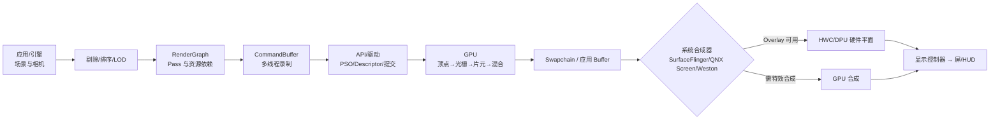

# GPU 与渲染引擎基础与链路

> **定位**：把散落在 01–07 的 GPU、图形管线、显式 API、批处理和系统合成知识收束成一条主线。读完后应该能回答：一个 draw call 从应用发出到屏幕点亮，中间经过了哪些层，每层在做什么，瓶颈会落在哪里。
>
> **验证状态**：✅已验证（图形学/API 规范与公开架构）/ ⚠️有条件成立（驱动、厂商与场景差异）/ ❗待验证（具体芯片行为）
>
> **配套**：[图形与GPU工程](图形与GPU工程.md) · [光栅化深度与移动GPU架构](光栅化深度与移动GPU架构.md) · [显式API与同步原语](../04-跨平台与高性能架构/显式API与同步原语.md) · [批处理与GPU驱动管线](../07-3D渲染与算法实现/批处理与GPU驱动管线.md)
>
> **延伸**：[智驾渲染方案](../04-跨平台与高性能架构/智驾渲染方案.md)（本文链路在车载/智驾场景的具体化）

---

## 0. 一页总览：三张视角图

**硬件视角**：GPU 是一组并行计算单元 + 固定功能单元 + 多级存储，目标是把大量相似工作摊到很多 lane 上，并用**延迟隐藏**保持单元忙碌。

**API 视角**：OpenGL/Vulkan/Metal/D3D12 是应用与驱动之间的契约。显式 API 把“驱动猜你要做什么”变成“你明确声明资源和依赖”。

**系统视角**：应用画出的 buffer 不是直接“显示在屏幕上”，而是交给系统合成器（SurfaceFlinger / QNX Screen / Weston），再由 HWC/DPU 决定硬件叠加还是 GPU 合成，最后扫描输出。

> 一句话：**渲染引擎不是“调用 `glDraw`”，而是把场景描述翻译成可预测的命令流、显存布局和同步关系，并在系统合成与显示时序约束下按时交付帧。**

---

## 1. GPU 硬件基础

### 1.1 并行模型：SIMD / SIMT / warp / wavefront

| 概念 | 含义 | 工程影响 |
|---|---|---|
| **SIMD** | 一条指令操作多个数据车道 | 向量化好时吞吐高；分支发散时浪费车道 |
| **SIMT** | 单指令多线程，典型如 NVIDIA warp | 一个 warp 内 lane 走不同分支会串行化 |
| **warp / wavefront** | GPU 调度的最小执行组（NVIDIA 32 lane，AMD 64 lane 常见）⚠️ | 分支发散、访存合并、寄存器压力都按组分析 |
| **thread / invocation** | 每个顶点或片元对应的一次着色器执行 | 片元数量通常远大于顶点数量，填充率常先触顶 |

**关键认知**：GPU 擅长“很多像素做同一件事”，不擅长“每个像素走不同分支”。所以移动端/车机 shader 里要谨慎使用动态分支、`discard` 和大循环。

### 1.2 存储层次与带宽

```
寄存器 / 私有内存    最快，容量最小，数量决定 occupancy
   ↓
shared memory / tile memory   片上，低延迟，TBDR 的主战场
   ↓
L1 / L2 cache                 缓存纹理与附件访问
   ↓
显存 / 系统内存                带宽最贵，跨芯片边界更贵
```

**带宽估算模板**：

```
外部带宽 ≈ Σ(每个 Pass 的 load + store) + 纹理采样读 + 顶点读 + MSAA resolve
```

1080P RGBA8 一次全屏写 ≈ 7.9 MB；60 FPS 下单次写就是 ≈ 475 MB/s。一个 5 Pass 后处理链很容易到 GB/s 量级 ✅。详见 [光栅化深度与移动GPU架构 §3](光栅化深度与移动GPU架构.md#3-overdraw-与带宽)。

**算术强度**：`运算量 / 访存量` 越高，越不容易被带宽卡住。片元着色器若只是简单混合，通常是**带宽受限**；复杂 PBR/光照则更可能**算力受限**。

### 1.3 延迟隐藏与占用率

- GPU 通过切换 warp/wavefront 隐藏纹理采样和显存访问延迟。
- **Occupancy（占用率）** = 实际活跃 warp 数 / 理论最大 warp 数。
- 提高占用率的手段：减少每线程寄存器、减少 shared memory 占用、控制线程块大小。
- 但**高占用率不是目标本身**：如果瓶颈是带宽，增加线程只会更快把带宽打满。

### 1.4 固定功能与可编程单元

| 单元 | 典型职责 | 是否可编程 |
|---|---|---|
| 顶点/几何前端 | 顶点抓取、索引、图元装配 | 部分（顶点/几何/细分着色器） |
| 光栅化器 | 三角形覆盖、插值、Early-Z | 固定 + 状态配置 |
| 纹理单元 TMU | 采样、过滤、mipmap | 固定 + 采样器参数 |
| 片元/着色器核心 | 像素计算 | 可编程 |
| ROP / 混合单元 | 深度/模板、Alpha 混合、写回 | 固定 + 状态配置 |
| 视频/显示单元 | VPU 编解码、DPU/Overlay 合成 | 固定 + 寄存器配置 |
| NPU / Tensor Core | 矩阵乘、推理 | 专用指令/API |

**车载含义**：视频、相机、Overlay 尽量交给 VPU/DPU；GPU 只处理真正需要可编程的部分。这不是“偷懒”，而是功耗和确定性的要求。

### 1.5 别只看 TOPS

- **TOPS** 是峰值算力，不代表实际帧率。
- 真实瓶颈常是：带宽、同步等待、DrawCall 提交、Shader 分支发散、Overdraw、显示合成。
- 车机更应看：**P99 帧时间、最坏帧延迟、热稳定性、启动时间**，而不是峰值吞吐。

---

## 2. 渲染引擎的核心组成

### 2.1 从场景到命令

```
场景数据（网格/材质/灯光/相机）
  ↓ 视锥剔除 / 遮挡剔除 / LOD 选择
可见对象列表
  ↓ 按 PSO / 材质 / 纹理排序，减少状态切换
RenderGraph：Pass 依赖关系 + 资源生命周期
  ↓ 编译：分配显存、决定 aliasing、插入 barrier
CommandBuffer 录制
  ↓ 提交到图形/计算/传输队列
GPU 执行
  ↓ present
系统合成器 → 显示
```

**RenderGraph 的价值**：把“谁写哪张纹理、谁读哪张纹理、什么时候可以释放”变成 DAG，从而做显存复用（aliasing）和自动同步插入 ✅。详见 [跨平台与高性能架构 §2](../04-跨平台与高性能架构/跨平台与高性能架构.md#2-rendergraph-架构设计)。

### 2.2 资源系统

| 资源 | 作用 | 生命周期要点 |
|---|---|---|
| Buffer | 顶点、索引、Uniform、SSBO | 是否持久映射？是否每帧重建？ |
| Image / Texture | 颜色、深度、法线、RTT | 格式、mip 层数、usage flags |
| Sampler | 过滤与寻址模式 | 与 image 解耦（Vulkan） |
| RenderTarget / Framebuffer | Pass 输出目标 | load/store action 直接影响带宽 |
| Descriptor / BindGroup | 资源绑定集合 | 更新频率决定可否复用 |
| Pipeline / PSO | shader + 固定功能状态 | 预热与变体治理，避免运行期编译 |

### 2.3 管线与状态

- OpenGL：全局状态机，每次 draw 前驱动做状态校验 ⚠️。
- Vulkan/Metal/D3D12：PSO 把状态一次性固化，应用负责正确性。
- **Shader 变体**是隐形炸弹：`#define` 组合爆炸会导致首次使用卡顿或包体膨胀。车机项目要**离线编译 + 管线缓存 + 变体裁剪** ✅。

### 2.4 同步与调度

- **Fence**：CPU 等 GPU。
- **Semaphore**：队列之间 / swapchain 同步。
- **Barrier**：资源状态转换与内存可见性。
- **Frame in flight**：CPU 可以领先 GPU 1–3 帧，但必须有上限，否则输入延迟变大 ✅。

详见 [显式API与同步原语](../04-跨平台与高性能架构/显式API与同步原语.md)。

### 2.5 帧循环模板

```
while (running) {
  pollInput();
  updateSimulation(dt);        // 只读上一帧渲染结果，避免反馈同步
  updateSceneGraph();
  cullAndBuildRenderGraph();
  recordCommandBuffers();      // 可多线程
  submit(queue, cmd, sync);
  present(surface);
}
```

**工程红线**：不要在渲染线程里做 `glReadPixels`、同步 map、等待文件 IO、等待网络。任何“等一下”都会变成帧时间尖刺。

---

## 3. 一帧的端到端链路

### 3.1 通用链路图



### 3.2 各阶段职责与瓶颈

| 阶段 | 输入 → 输出 | 常见瓶颈 | 对应优化 |
|---|---|---|---|
| 场景更新 | 游戏/车况数据 → 可见对象 | 逻辑耗时、锁竞争 | 多线程任务图、双缓冲数据 |
| 剔除/LOD | 对象列表 → 可见列表 | CPU 遍历、过度剔除不准 | 层次包围体、GPU culling |
| RenderGraph 编译 | Pass DAG → 资源计划 | 图编译开销、过度同步 | 缓存编译结果、aliasing |
| 命令录制 | Pass → CommandBuffer | DrawCall 数、状态切换 | 合批、PSO 排序、多线程录制 |
| GPU 执行 | 命令 → 像素 | 填充率、带宽、分支发散 | 降分辨率、减 Pass、Early-Z |
| 提交/呈现 | Buffer → 合成器 | fence 等待、队列拥塞 | 控制 in-flight 帧数 |
| 系统合成 | 多图层 → 显示帧 | Overlay 平面不足、GPU 回退 | 对齐 HWC 格式/尺寸 |
| 扫描输出 | 显示帧 → 光子 | vsync 相位、面板响应 | frame pacing、低延迟模式 |

### 3.3 双缓冲、三缓冲与 frame pacing

- **双缓冲 + VSync**：解决画面撕裂。
- **三缓冲**：吸收 CPU/GPU 偶发超时，让帧节奏更稳；代价是多一帧排队延迟 ⚠️。
- **Frame pacing**：不是“尽快提交”，而是“按显示节奏准时提交”。车载仪表尤其重要，因为它与指针/警示灯的可信度相关。
- **Jank ≠ pacing 抖动**：长帧是某帧算太慢；pacing 抖动是帧完成时间不均匀。三缓冲治后者，不治前者。

### 3.4 视频/相机参与时的分支

```
相机/VPU 帧 → dmabuf / AHardwareBuffer
   ├─ 直接送 HWC Overlay → 屏（最低延迟，无特效）
   ├─ EGLImage / VkImage → GPU 纹理 → 特效链 → 合成
   └─ NPU 输入 → 感知结果 → 可视化层 → GPU 渲染
```

- 零拷贝的目标是**消除 CPU 像素拷贝**，不是“硅片上零电荷移动” ✅。
- 需要特效才走 GPU；纯显示优先 Overlay。详见 [跨平台与高性能架构 §1](../04-跨平台与高性能架构/跨平台与高性能架构.md)。

### 3.5 智驾数据如何进入画面

智驾可视化不是“把摄像头画面投到屏上”，而是把感知/规划结果重新画成可理解的图形：

```
传感器 → ADAS SoC（推理）→ BEV/Occupancy/目标轨迹
   → 消息总线（SOME/IP、DDS 等，按项目）→ 座舱 SoC
   → 可视化引擎（GPU 绘制）→ 合成器 → 仪表/中控/HUD
```

安全警示（如 AEB 提示、接管请求）应有**不依赖复杂 3D 管线的兜底路径**。具体平台方案见 [智驾渲染方案](../04-跨平台与高性能架构/智驾渲染方案.md)。

---

## 4. 关键原理速查

### 4.1 五个“少”

1. **少提交**：合批、Instancing、Indirect Draw。
2. **少切换**：按 PSO/材质/纹理排序，减少状态换装。
3. **少搬数据**：零拷贝、tile memory、aliasing、避免回读。
4. **少等待**：fence 上限、异步队列、避免同步点。
5. **少不确定性**：预编译、预加载、固定预算、降级路径。

### 4.2 CPU 瓶颈还是 GPU 瓶颈？

| 现象 | 更可能的原因 | 验证实验 |
|---|---|---|
| DrawCall 减半但帧率不变 | GPU 填充/带宽受限 | 降分辨率，看帧率是否明显上升 |
| GPU 时间轴有气泡 | CPU 提交不足 | 看线程栈与 command buffer 录制耗时 |
| 帧时间 P99 尖刺 | 同步等待/编译/分配 | trace 中查 `glReadPixels`、map、alloc、shader compile |
| 温度上来后掉帧 | 功耗/频率限制 | 长时间稳定性测试 + 频率曲线 |

### 4.3 画质—帧率—功耗三角

- 提高分辨率/特效 → 带宽与填充率上升 → 帧时间变长、功耗上升。
- 车机不能只拉满画质，必须定义**档位**：正常 / 降级 / 安全路径。
- 降档顺序建议：后处理 → 分辨率 → 目标数量/LOD → 静态简化图 → 安全岛兜底。

### 4.4 带宽账模板（可直接套用）

```
颜色附件：分辨率 × 通道字节数 × (load + store)
深度附件：分辨率 × 深度字节数 × (load + store)
纹理采样：采样次数 × 分辨率 × texel 字节数
MSAA resolve：样本数 × 分辨率 × 4B
```

> 先算带宽，再谈算力。很多“优化 shader”最后不如“少一次全屏 Pass”有效。

---

## 5. 常见误区

| 误区 | 更准确的说法 |
|---|---|
| “Vulkan 一定比 OpenGL 快” | Vulkan 给的是**控制权**；写错同步一样慢，甚至更不稳定 |
| “DrawCall 越少越好” | 少到一定程度后瓶颈转到填充/带宽；要看 profiler |
| “零拷贝就是没有任何拷贝” | 是消除 CPU 侧像素拷贝；格式转换/D2D 仍可能有硬件成本 |
| “TOPS 高就不会卡” | 帧时间受带宽、同步、显示链路共同约束 |
| “三缓冲能解决掉帧” | 三缓冲平滑节奏，不治长帧 |
| “GPU 绘制完就上屏了” | 还要经过系统合成器、HWC/DPU 和显示控制器 |

---

## 6. 与全库其他文档的关系

| 想深入的方向 | 去哪里 |
|---|---|
| 固定管线与 FBO 实操 | [图形与GPU工程](图形与GPU工程.md)、[01-OpenGL管线-FBO与离屏渲染](../06-面试知识库/车载渲染引擎/01-OpenGL管线-FBO与离屏渲染.md) |
| 光栅化规则、TBDR/IMR、Early-Z | [光栅化深度与移动GPU架构](光栅化深度与移动GPU架构.md) |
| 显式 API 与同步 | [显式API与同步原语](../04-跨平台与高性能架构/显式API与同步原语.md) |
| 合批、GPU-driven、PSO 治理 | [批处理与GPU驱动管线](../07-3D渲染与算法实现/批处理与GPU驱动管线.md) |
| 色彩与 HDR | [色彩管理与采样滤波](色彩管理与采样滤波.md) |
| 车载/智驾方案 | [智驾渲染方案](../04-跨平台与高性能架构/智驾渲染方案.md)、[06-车载座舱专题](../06-面试知识库/车载渲染引擎/06-车载座舱专题与项目表达.md) |
