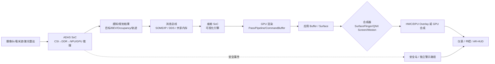

# 智驾渲染方案

> **定位**：从渲染工程师视角补齐“ADAS/AD 的计算结果如何变成驾驶员看到的画面”。这不是感知算法教程，而是把传感器、域控、座舱显示、功能安全和图形 API 串成一张可落地的方案图。
>
> **验证状态**：✅已验证（官方文档/规范）/ ⚠️有条件成立（平台配置与项目实现）/ ❗待验证（法规版本、具体 OEM 指标）
>
> **配套**：[GPU与渲染引擎基础与链路](../03-图形与GPU工程/GPU与渲染引擎基础与链路.md) · [06-车载座舱专题](../06-面试知识库/车载渲染引擎/06-车载座舱专题与项目表达.md) · [显式API与同步原语](显式API与同步原语.md)
>
> **说明**：文中涉及芯片/平台的数字均标注来源与条件；没有官方数据的地方不写具体数值。

---

## 0. 先分清三个域：计算域、显示域、安全兜底

智驾渲染最容易犯的错，是把“感知算法”和“把结果画出来”混为一谈。工程上通常分三层：

| 域 | 主要职责 | 典型硬件/软件 | 与渲染的关系 |
|---|---|---|---|
| **ADAS/AD 计算域** | 传感器接入、感知、定位、规划、控制 | 高性能 SoC / NPU / GPU；DriveOS、QNX、Linux 等 | 产出**结构化可视化数据**，不是直接画屏 |
| **座舱显示域** | HMI、仪表、中控、HUD、娱乐 | AAOS、QNX Screen、Weston；GPU + HWC/DPU | 把感知/规划结果画成图形并合成上屏 |
| **安全兜底域** | 关键警示、故障显示、降级画面 | 安全岛 / MCU / 独立显示通路 | 必须**不依赖复杂 3D 管线** |

**核心原则**：

> 感知结果可以来自 ADAS 域，但“刹车/接管/故障”这类安全信息不能被 GPU hang、着色器编译或系统合成器卡顿挡住。

⚠️ 舱驾融合 SoC 可以把计算域和显示域放在同一芯片上，但需要通过 hypervisor、内存隔离、QoS 和安全岛把故障域切开。

---

## 1. 典型端到端链路

### 1.1 数据流、控制流、时钟流



### 1.2 延迟分解

一帧“从传感器到光子”可粗分为：

```
传感器曝光 → 串行链路/CSI → DDR 缓冲 → 推理 → 结果发布
→ 跨域传输 → 可视化更新 → GPU 渲染 → 合成 → 面板扫描输出
```

**渲染工程师能控制的**：跨域数据布局、可视化更新频率、GPU Pass 数、同步等待、合成路径。

**关键工程手段**：

1. 每个可视化对象带 **sensor timestamp / frame id**，避免把不同时刻的目标画进同一帧。
2. 订阅侧使用**最新帧覆盖**策略，落后帧直接丢弃，不要排队追帧。
3. 网络/共享内存数据按 **double-buffer + 序号** 读取，避免读到半更新状态。
4. HUD/仪表使用独立 swapchain，不与娱乐屏共享 vsync 节奏。
5. 安全警示走独立通道，渲染层只做“呈现”，不做“判定”。

---

## 2. 平台方案对照

### 2.1 NVIDIA DRIVE

**DriveOS 官方定位**：面向自动驾驶的车规 OS，安全与安全方法论由 TÜV SÜD 认证，符合 ASPICE、ISO 26262、ISO/SAE 21434，并支持异构冗余 ✅。DriveOS 允许 Linux 或 QNX 作为应用 OS，由 Hypervisor 管理资源并提供隔离；Guest OS 提供额外隔离与冗余 ✅。[来源](https://developer.nvidia.com/drive/driveos)

**图形与窗口 API**（DriveOS 7.0.3 Linux SDK 官方列表）✅：

| 类别 | API |
|---|---|
| Graphics | OpenGL、OpenGL ES、Vulkan、**Vulkan SC** |
| Windowing | X11、Wayland、EGLDevice/EGLOutput、Screen |
| 显示 | NvDisplay |
| 传感器/媒体 | NvMedia、NvSIPL、NvStreams、EGLStreams |
| 计算 | CUDA、TensorRT、cuDNN、PVA SDK |

[来源](https://developer.nvidia.com/docs/drive/drive-os/7.0.3/public/drive-os-linux-sdk/introduction/introduction_to_driveos_sdk_apis.html)

**渲染相关要点**：

- **NvMedia** 可把相机帧直接载入 GPU 显存，**NvStreams** 在硬件加速器之间做零拷贝传输 ✅。
- **CUDA / TensorRT** 让感知与渲染共享同一 GPU 内存域时，要特别注意队列同步与资源生命周期 ⚠️。
- DRIVE AGX Orin 官方产品简报标称 **254 INT8 TOPS**；这是峰值指标，不是实际渲染帧率 ✅。[来源](https://www.nvidia.cn/content/dam/en-zz/Solutions/self-driving-cars/drive-platform/auto-print-drive-product-brief-final.pdf)
- 仿真侧：官方当前以 **Omniverse NuRec** 做真实多传感器数据的神经重建，用 Cosmos 生成天气/光照/长尾场景，用 **AlpaSim** 做闭环测试；页面写明“planned / targeting up to 11 camera views including fisheye”，属于规划能力，不能写成当前已交付规格 ⚠️。[来源](https://developer.nvidia.com/drive/drive-sim)

### 2.2 Qualcomm Snapdragon Ride / Ride Flex

- 官方将 **Snapdragon Ride Flex** 定位为“汽车行业首款同时支持数字座舱与 ADAS 的可扩展系列 SoC” ✅。[来源](https://www.qualcomm.cn/news/releases-2023-01-04-0)
- **Snapdragon Ride SDK** 支持从 L1 到 L3 的 ASIL-compliant ADAS 开发；AI SDK 可在 **GPU / CPU / Hexagon HTP** 上运行 DNN；Qualcomm ADAS APIs 提供优化过的 3D 变换、图像转换、张量与矩阵运算，用于降低安全关键 pipeline 的端到端延迟 ✅。[来源](https://developer.qualcomm.com/software/digital-chassis/snapdragon-ride/tools)
- SDK 明确针对 **latency / memory / bandwidth** 做优化，并提供 CPU、GPU、内存、功耗、热力 profiling ✅（同上）。
- Adreno GPU 在 Android/AAOS 侧以 Vulkan 为主，OpenGL ES 仍兼容但不再是主要演进方向 ⚠️。[参考](https://developer.android.com/games/develop/vulkan/overview)
- ⚠️ 具体屏数、分辨率、安全岛细节以对应 SoC datasheet 与 OEM 集成文档为准，不从新闻稿外推。

### 2.3 座舱 OS 与图形栈

| 平台 | 图形栈 | 多屏/隔离要点 | 渲染影响 |
|---|---|---|---|
| **AAOS** | SurfaceFlinger + HWC/DPU | Android 10 起用 `Presentation` 支持外接显示；图形化仪表可作为**虚拟显示器**挂在 Display HAL 之后 ✅ | 每屏独立 Surface/时序；`Presentation` 是 dialog，不能投影整个 Activity，外接屏无直接触摸事件 ✅。[来源](https://source.android.google.cn/devices/automotive/displays?hl=zh-tw) |
| **QNX** | QNX Screen | QNX Hypervisor for Safety 8.0 预认证 ISO 26262 ASIL D / IEC 61508 SIL3 / IEC 62304 Class C；安全 OS 与 Android/Linux 在强隔离域并存，支持 para-virtualized devices ✅ | 仪表/警示常放安全域；娱乐放非安全域。[来源](https://qnx.software/en/software/products-and-solutions/qnx-hypervisor-and-hypervisor-for-safety) |
| **Linux + Wayland/Weston** | DRM/KMS + Weston | 开源栈灵活，但实时性与认证需项目自行保证 ⚠️ | 适合域控/娱乐屏；安全关键显示要额外隔离 |
| **ACRN** | Type 1 hypervisor + I/O mediator | 支持资源分区与跨 VM 设备共享 ⚠️ | GPU 可能走 virtio-GPU / Venus / 直通，需测转发开销 |

**AAOS 安全仪表架构**：官方说明安全关键仪表渲染与 Android 可以在同一多核 SoC 上，例如 Cortex-R 跑 RTOS、Cortex-A 跑 Android，通过以太网 AVB / LVDS / HDMI 连接；图形仪表也可作为虚拟显示器隐藏在 Display HAL 后 ✅。

**虚拟化下的 GPU 选择**：

| 方案 | 优点 | 代价 |
|---|---|---|
| GPU 直通 | 性能最好、延迟可预测 | GPU 被单个 VM 独占 |
| virtio-GPU + virgl (OpenGL) | 兼容性好 | 转发开销，功能受限 |
| virtio-GPU + Venus (Vulkan) | 更接近原生 | 驱动与版本匹配要求高 |
| SR-IOV / 硬件分片 | 多 VM 共享且隔离 | 依赖 SoC/驱动支持 ❗ |

详见 [06-车载座舱专题 §1.4](../06-面试知识库/车载渲染引擎/06-车载座舱专题与项目表达.md)。

### 2.4 安全关键图形 API：Vulkan SC

**Vulkan SC** 是 Khronos 基于 **Vulkan 1.2** 的安全关键 API，目标是 ISO 26262 **ASIL D** 等安全标准 ✅。其确定性来自：

- 离线管线编译（offline pipeline compilation）
- 静态内存分配（static memory allocation）
- 显式同步与对资源管理的高度控制
- 消除被忽略参数与未定义行为，增强运行时错误检测/上报/纠正

Khronos 官方列出符合规范的实现包括 **CoreAVI VkCore SC** 与 **NVIDIA DRIVE / Jetson 平台**；Vulkan SC Emulation Layer 明确**非 conformant、不可用于生产** ✅。[来源](https://www.khronos.org/vulkansc/)

> **工程判断**：安全关键渲染不是“换个 API 就安全了”，而是把动态行为（编译、分配、同步、错误恢复）前置到可验证的离线阶段。

---

## 3. 智驾可视化要画什么

| 对象 | 数据来源 | 推荐 GPU 表达 | 性能/安全要点 |
|---|---|---|---|
| **3D 车模** | 车身模型 + 状态（门/灯/转向） | PBR + IBL + 有限实时光源 | LOD、烘焙光照、限制阴影更新 |
| **BEV 俯视图** | 感知融合后的鸟瞰结果 | 正交相机 + 纹理地面 + 实例化目标 | 纹理分块加载，避免每帧全量重建 |
| **Occupancy Network** | 体素/占用栅格 | Instanced cube / 3D texture slice / 点云 shader | 数量大，必须 LOD/裁剪；颜色语义要固定 |
| **目标框/车道线** | 检测/跟踪结果 | 线段 instancing / SDF 样式 | 线宽一致性、抗锯齿、时间平滑 |
| **规划轨迹** | 路径点/速度剖面 | Ribbon mesh / tube | 与自车位姿使用同一时间戳 |
| **环视 AVM** | 4 路鱼眼相机 | 去畸变 LUT + 拼接 + 融合 | 零拷贝相机纹理，曝光一致，拼接缝校正 |
| **AR-HUD 引导** | 导航/感知 + 车辆姿态 | 投影空间叠加 + 畸变校正 | 低延迟、标定、亮度、视差与抖动控制 |
| **DMS/OMS** | 车内摄像头 | 纹理化视频 + 简单标注 | 隐私与权限隔离，避免不必要回读 |

### 3.1 BEV / Occupancy 的渲染原则

- **语义稳定**：同一类对象跨帧颜色/形状一致，不能因排序或哈希变化而跳变。
- **时间一致**：所有对象使用同一帧 ID；落后帧丢弃而不是补帧。
- **数量可控**：设置最大绘制数，超出时按置信度/距离裁剪。
- **语义优先于写实**：智驾可视化是“可理解的仪表”，不是游戏画面；不要为特效牺牲可读性。
- **安全信息单独图层**：接管请求、碰撞风险等用固定图层，不被 3D 场景遮挡。

### 3.2 与仿真/离线的衔接

NVIDIA 当前公开的 Omniverse NuRec + Cosmos + AlpaSim 路线，本质是把真实数据重建为可交互 3D 场景，再生成长尾场景做闭环验证 ✅。渲染团队可以复用这套思路：

- 用同一套可视化规则做**实车 HMI** 和**仿真回放**，减少“仿真好看、实车对不上”的偏差。
- 把相机模型、车辆姿态、时间戳作为渲染输入的一部分，而不是后处理补丁。
- 神经渲染/3DGS 目前更适合离线仿真与数据生成，车端实时 HMI 仍以传统光栅化为主 ⚠️。

---

## 4. AR-HUD 与多屏方案

### 4.1 AR-HUD 的特殊约束

| 约束 | 原因 | 应对 |
|---|---|---|
| 低延迟 | 引导箭头必须与真实道路“贴住” | 预测补偿、专用显示通路、减少合成层级 |
| 标定 | 摄像头/投影仪/vehicle pose 需对齐 | 出厂标定 + 运行时姿态补偿 |
| 畸变 | 挡风玻璃曲面与投影几何 | 逆向畸变网格、预扭曲纹理 |
| 亮度/对比度 | 白天强光下仍要可读 | 高亮度面板、局部调光、语义色稳定 |
| 抖动 | 车辆振动导致画面漂浮 | 时域平滑 + 运动补偿，但避免过度滞后 |

> AR-HUD 的“对齐误差”是安全问题，不是美术问题。宁可信息少一点，也不能把引导画到错误车道。

### 4.2 多屏架构选择

| 方案 | 说明 | 适用 |
|---|---|---|
| 单引擎多视口 | 一个进程/上下文渲染多屏 | 资源共享好，故障域大 |
| 多进程隔离 | 每屏独立进程 | 安全隔离好，资源重复 |
| 混合 | 仪表独立，中控/后排共享 | 车机最常见 ⚠️ |

每屏应有独立 swapchain/EGLSurface，并明确：

- 刷新率与 vsync 相位
- DPI / 安全区域 / 异形屏裁剪
- 合成器中的图层优先级
- 掉帧策略（保留最后一帧 vs 显示降级图）

---

## 5. 性能与实时性预算

### 5.1 预算表模板

| 指标 | 目标 | 测量方式 |
|---|---|---|
| 端到端延迟 | 按 OEM/法规定义 ❗ | 传感器打时间戳到屏幕光电/相机拍屏 |
| 帧率 | 仪表常固定 60 Hz，中控可动态 ⚠️ | 合成器与面板上报 |
| P99 帧时间 | 按帧预算，如 16.7 ms | Perfetto / Systrace / GPU trace |
| GPU Pass 数 | 越少越好 | RenderGraph 编译报告 |
| 显存峰值 | 按 SoC 预算 | 分配器统计 |
| 热稳定性 | 长时间不降频到不可接受 | 高温环境 + 长稳测试 |

> 不写具体毫秒数的原因：不同传感器、总线、SoC、面板和 OEM 规范差异很大，必须按项目定义 ❗。

### 5.2 降级阶梯

```
L0 正常：完整 BEV/Occupancy + 后处理 + 3D 车模
  ↓ GPU 负载/温度/延迟超标
L1 降画质：关后处理、降分辨率、减少体素/目标数
  ↓ 仍不满足
L2 降内容：切换简化 2D 俯视图、静态车道底图
  ↓ 严重故障
L3 安全路径：安全岛输出关键警示与最小可读画面
```

降级必须**可预测、可测试、可回退**，并且不能改变安全语义（例如把红色警示降级成不显眼的样式）。

---

## 6. 功能安全与信息安全

| 主题 | 渲染侧落点 |
|---|---|
| **ASIL 分解** | 关键警示高 ASIL；娱乐 QM；中间层按功能拆分 |
| **故障检测** | 黑屏/冻结/花屏检测、GPU fence 超时、E2E CRC + 计数器 |
| **Fail-safe** | 最后一帧保持、独立安全图层、安全岛兜底 |
| **Watchdog** | 覆盖 CPU 线程与 GPU 完成状态，不能只喂软件狗 |
| **ISO 21434** | 摄像头/用户数据处理权限隔离，外部 buffer 边界校验，OTA 签名与回滚 |
| **资源隔离** | Hypervisor 分区、QoS、内存带宽预算，避免娱乐挤占仪表 |

⚠️ 锁步核、具体 watchdog 时限、RVC 出图时限等属于项目/法规细节，本文不写死数值；请以 OEM 规范与适用法规版本为准。

---

## 7. 方案选型 Checklist

拿到一个智驾渲染需求，先问这些：

1. **算力与图形栈**：哪颗 SoC？GPU 型号？OpenGL ES / Vulkan / Vulkan SC？是否有安全认证驱动？
2. **域划分**：ADAS 与座舱同芯片还是分芯片？跨域接口是共享内存、SOME/IP 还是 DDS？
3. **屏幕**：几块屏？分辨率/刷新率？是否有 AR-HUD？哪些屏是安全相关？
4. **数据**：感知结果频率、时间戳、最大对象数、BEV/Occupancy 表示方式？
5. **延迟**：从传感器到显示的预算由谁定义？如何端到端打点？
6. **安全**：哪些信息必须走安全路径？GPU hang 时显示什么？
7. **工具链**：RenderDoc / Nsight / AGI / Perfetto / dumpsys 是否可用？产线如何回归？
8. **生命周期**：10–15 年 OTA 下，shader、驱动、字体、地图资源如何兼容？

**红旗信号**：

- 把安全警示只画在 3D 场景里；
- 用平均帧率代替 P99；
- 每帧重建 GPU 资源或编译 shader；
- 多屏共用一个 vsync 假设；
- 把“TOPS 高”当成渲染性能结论。

---

## 8. 60 秒口述模板

> “我会先把智驾渲染拆成三个域：ADAS 计算域产出结构化结果，座舱域负责画出来，安全岛负责最小警示兜底。链路上关注时间戳与帧 ID，避免把不同时刻的目标画进同一帧；渲染侧用 RenderGraph 控制 Pass 与显存，尽量让相机/视频走零拷贝和 Overlay，只有需要特效时才进 GPU。多屏和 AR-HUD 有独立时序，不能用一个 vsync 假设。安全上，关键警示不能依赖复杂 3D 管线，要有独立路径和降级策略。性能用 P99 帧时间和端到端延迟衡量，而不是只看平均帧率和 TOPS。”

**常见追问**：

| 追问 | 回答方向 |
|---|---|
| “Vulkan SC 和普通 Vulkan 有什么区别？” | 基于 Vulkan 1.2，离线编译/静态内存/显式同步，面向 ASIL D，见 §2.4 |
| “BEV 和 Occupancy 怎么画？” | 实例化、3D texture、LOD/裁剪，语义稳定优先，见 §3.1 |
| “AR-HUD 最大难点？” | 对齐与延迟，不是画质；标定 + 预测补偿 + 专用通路，见 §4.1 |
| “舱驾融合后 GPU 怎么隔离？” | Hypervisor、QoS、直通/virtio/SR-IOV，见 §2.3 |
| “怎么证明不黑屏？” | 安全岛兜底、最后帧保持、fence 超时、E2E、故障注入测试 |

---

## 9. 参考来源

- NVIDIA DriveOS：<https://developer.nvidia.com/drive/driveos>
- NVIDIA DriveOS 7.0.3 SDK APIs：<https://developer.nvidia.com/docs/drive/drive-os/7.0.3/public/drive-os-linux-sdk/introduction/introduction_to_driveos_sdk_apis.html>
- DRIVE AGX 产品简报：<https://www.nvidia.cn/content/dam/en-zz/Solutions/self-driving-cars/drive-platform/auto-print-drive-product-brief-final.pdf>
- NVIDIA DRIVE Sim / Omniverse NuRec / AlpaSim：<https://developer.nvidia.com/drive/drive-sim>
- Qualcomm Snapdragon Ride Flex 新闻稿：<https://www.qualcomm.cn/news/releases-2023-01-04-0>
- Qualcomm Snapdragon Ride SDK：<https://developer.qualcomm.com/software/digital-chassis/snapdragon-ride/tools>
- Khronos Vulkan SC：<https://www.khronos.org/vulkansc/>
- AOSP Automotive Displays：<https://source.android.google.cn/devices/automotive/displays?hl=zh-tw>
- QNX Hypervisor for Safety：<https://qnx.software/en/software/products-and-solutions/qnx-hypervisor-and-hypervisor-for-safety>
- ACRN Project：<https://projectacrn.org/>
- Android Vulkan 指南：<https://developer.android.com/games/develop/vulkan/overview>
